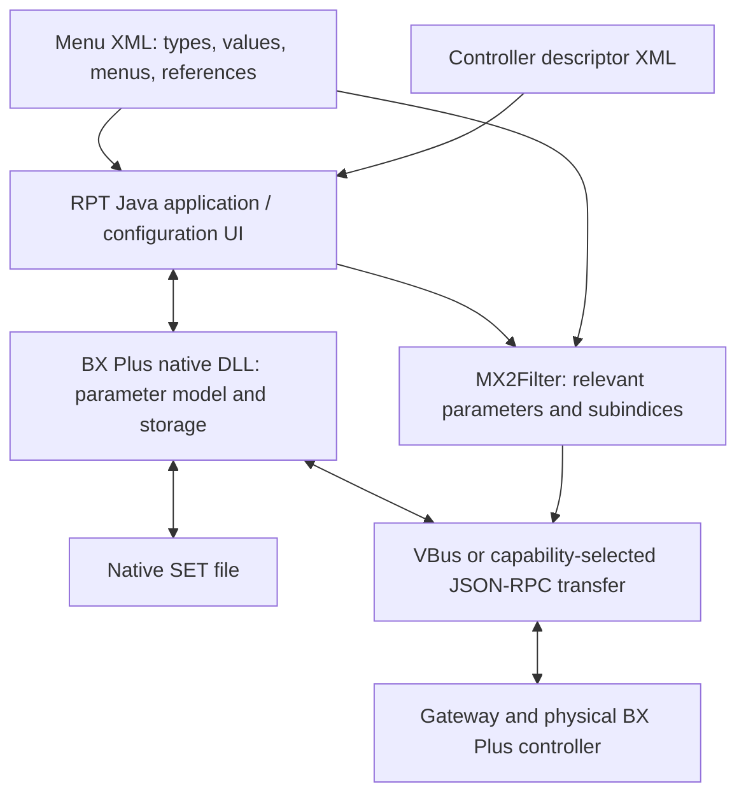
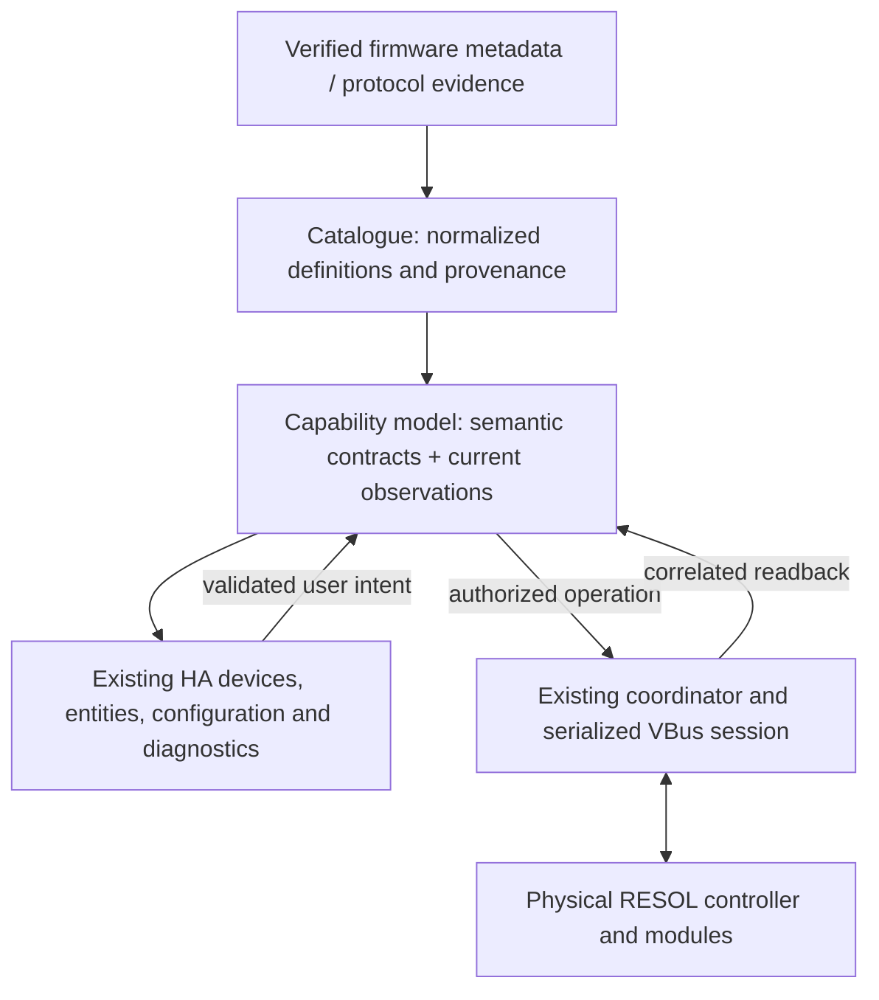

# RESOL DeltaSol BX Plus — interoperability research and integration architecture

**Research baseline:** RPT 2.02 / DeltaSol BX Plus firmware 2.08 · 28 November 2026  
**Status:** Whole-stack investigation in progress; static findings recorded, implementation and runtime qualification incomplete.  
**Implementation baseline:** [cc2ed482](https://github.com/npinguin/hass-Deltasol-KM2/commit/cc2ed482bf9e0183343bf94c4383e7593bb81a85) · [configuration scope #10](https://github.com/npinguin/hass-Deltasol-KM2/issues/10) · [development PR #18](https://github.com/npinguin/hass-Deltasol-KM2/pull/18).

## 1. Why this research matters

The original Home Assistant integration provides valuable access to RESOL telemetry through gateways such as the KM2. Reading measurements is not the same problem as understanding the configuration of the controller behind that gateway. A temperature, relay state or parameter name does not establish which equipment is installed, whether a setting is meaningful, whether it can be changed or whether a change survives a restart.

The goal of this work is a complete, maintainable configuration and operational integration for the supported BX Plus controller, rather than a collection of individually reverse-engineered controls. An owner should be able to discover the actual controller and modules, inspect their real settings and adjust supported operating parameters through native Home Assistant controls. An engineer should be able to understand unavailable capabilities, validate changes and diagnose communication failures. The controller remains responsible for autonomous operation and safety.

To get there, we investigated the entire relevant RESOL RPT-to-controller stack: the Windows installer, Java application, controller import package, menu/type definitions, native firmware-model DLL, parameter addressing, offline SET files, VBus commands and storage lifecycle. This is interoperability research at controller-system level, not merely a packet capture or a list of register addresses. It is also not a claim that every firmware routine, conditional function or physical behavior has been verified.

The upstream proposal is to reuse the existing integration and extend it with a coherent, evidence-driven configuration engine. No second application, Windows runtime, vendor DLL dependency or replacement control system is required in Home Assistant.

## 2. Research sources and method

We used three complementary kinds of evidence:

| Source | What it can establish | What it cannot establish alone |
| --- | --- | --- |
| RPT 2.02 application and BX Plus 2.08 import package | Vendor-side structure, parameter types, selection logic, native encoding and command implementation | Behavior of every deployed controller or physical persistence |
| Two genuine controller SET exports, before and after a timer configuration change | Actual storage records and differences produced by the native configuration workflow | Live VBus acknowledgement, safe write access or physical power-cycle retention |
| Existing integration, upstream protocol references and earlier field diagnostics | Current implementation, protocol conventions, actual communication symptoms and regressions | A successful end-to-end qualification of the new candidate |

The installer was extracted offline without executing it. Java bytecode and the native DLL were inspected statically; XML definitions and binary tables were compared systematically, and both SET files were parsed and compared. Native entry points and relative virtual addresses (RVAs) are recorded in the technical appendix for reproducibility. No vendor source code, binaries, private configuration files, credentials or site values are included in this document or proposed for distribution.

Evidence terminology used throughout:

- **Static verified:** a relationship is demonstrated in the examined binary, XML or file data.
- **Observed:** an actual capture or export contains the stated evidence.
- **Inferred:** a plausible interpretation still needs independent confirmation.
- **Qualified:** the implemented behavior has passed its relevant runtime acceptance test. Source tests and simulated peer behavior do not by themselves establish physical behavior.

The firmware package examined here has the same controller address and changeset as the package currently pinned by the integration, but a different archive digest. Member-level equivalence must be established before promoting the new binary findings to the existing registered catalogue trust boundary. A matching changeset is not a substitute for verifying the source.

## 3. How RESOL RPT actually works

RPT is more than a graphical editor. It loads a controller-specific package that combines a declarative description with a native implementation of the controller's parameter model. The native model is used to interpret and transfer configuration, while the Java layer manages the menu, selection and communication workflow.



The diagram is a conceptual view of the observed responsibilities, not a claim that every RPT execution path follows a single call sequence.

The descriptor identifies the controller, firmware version, changeset, native library, menu XML, parameter filter and storage format. The menu XML describes values, inherited types, units, limits, defaults, references and menu conditions. The native DLL contains parameter lookup tables, internal data representation and storage conversion. The Java application queries and transfers the appropriate values, using firmware-specific selection and capability-dependent communication paths.

The essential distinction is between **what could exist in a controller family**, **what is present in the installed configuration**, **what can currently be read**, and **what can safely be edited**. These are separate questions.

## 4. What the BX Plus investigation established

### 4.1 Controller identity and complete definition inventory

| Item | Observed result |
| --- | --- |
| Controller | RESOL DeltaSol BX Plus 2.08 |
| Controller address | `0x7112` |
| Changeset | `0x2734DABC` |
| RPT parameter filter | `MX2Filter` |
| Storage version | 3 |
| Menu XML | 15,680 value definitions; 993 menus |
| Native parameter table | 15,683 IDs |
| XML-to-native index coverage | All 15,680 XML indices found in the native table |
| Native hash/index matches | 10,649 XML entries |
| XML-only hashes | 5,031 with no native hash mapping |

Three additional native entries, 54, 57 and 58, correspond to descriptor skip-on-write IDs. Their presence is not permission to expose them as configuration controls.

The distinction between index coverage and hash coverage is important: a definition may exist at a native index without being addressable through the hash lookup. A failed hash lookup is not proof that the value cannot be read by another verified method. Equally, an index in the table is not proof of availability or write access. Discovery must report those distinctions instead of inventing values or silently excluding unknowns.

### 4.2 Types, menu conditions and dynamic configuration

The catalogue contains inherited types, display and storage scaling, enumerations, units, quantization, defaults and conditional references. The Java MX2Filter selects parameters iteratively using controlling values and menu/storage membership.

Examples of selectors include:

| Family | Relevant context |
| --- | --- |
| Solar base and dedicated solar functions | Solar SystemId and native function context |
| Generic optional functions | Function Type and selected instance |
| Extension modules | Module activation and observed module identity |
| Heating circuits and functions | Circuit/function type and installed assignments |
| Heat quantity meters | Meter type and configured inputs |
| Weekly programs | Allocation, initialization and function references |

This selection mechanism explains why a flat list of every XML value is not an adequate configuration UI. It also suggests a more efficient discovery order: read controlling values first, then prioritize their dependent values, while retaining complete safe readable coverage and explicit unresolved results.

Important limitation: the RPT transfer filter is not a complete semantic permission model. In particular, a nonzero SystemId does not by itself establish a specific hydraulic topology, and the precise menu masks, compound dependencies and native assignment semantics are not yet fully reconciled. Do not infer applicability from function ordinals or write permission from menu membership.

### 4.3 Offline SET files

The two actual SET exports each contain 107 blocks of 512 bytes and 7,493 unique parameter records. All records map to native IDs; 7,492 map to XML definitions and one maps to extra native ID 54. Both files have the same key set, with 19 changed values. All 107 block-header CRCs per file were verified.

The 7,492 XML-matched stored records omit an explicit XML storage attribute. Absence of that attribute is therefore not sufficient to classify a parameter as nonpersistent or unsupported. Conversely, a parameter appearing in a SET file does not automatically establish that it is safe to write through Home Assistant.

SET files are useful independent evidence for storage layout and round-trip tests. They are not a proposed second live configuration store, and importing a full SET file into a physical controller is outside the agreed integration scope.

### 4.4 Weekly timer: from native bytes to a usable schedule

The controller has 51 weekly program slots (Wsu0 through Wsu50), with seven daily payloads per slot. Each day contains six start/end pairs. An allocated and initialized program differs from an unallocated slot; references from functions link to programs and may not be assumed to confer exclusive ownership.

| Property | Verified representation |
| --- | --- |
| Daily payload | 12 bytes / three 32-bit words |
| Daily values | Six start/end pairs |
| Time unit | 15 minutes |
| Native range | 00:00–23:45 (0–95) |
| Unused pair | FF FF |
| Native descriptor | 0x400C for all 357 timer-day parameters |
| Word order | Successive groups of four bytes, little-endian |
| Allocation and initialization | Separate native parameters |

For a synthetic example, 08:00–10:00 becomes byte values 32 and 40 (hex 20 and 28). Unused trailing pairs are FF FF. This example is not a site configuration.

```text
Day bytes:  20 28 FF FF | FF FF FF FF | FF FF FF FF
Subindex:       0       |      1      |      2
Word:       0xFFFF2820  | 0xFFFFFFFF  | 0xFFFFFFFF
```

The JNI read/write routines, native SET serialization and native VBus parameter handler address the same underlying byte buffer at subindex × 4. The Java filter calculates the number of subindices from the inherited size. This is direct static evidence of the encoding, independent of plausible-looking decoded values.

**Implementation finding:** the current Python catalogue parser looks for a child element named size, whereas this firmware's type declares size="12" as an attribute. Correcting inheritance handling will remove an unnecessary workaround for these timer definitions once the registered archive is reconciled.

The static mapping is now established for the examined DLL. Full schedule ownership, live coherent reads, validated editing and failure recovery are still required before the schedule can be called delivered. No fictitious midnight sentinel or unrestricted Blob editor is needed.

### 4.5 Parameter writes, storage and bulk transactions

A controller parameter can represent a live value, volatile operating command, persistent setting or internal state. Their transport and storage behaviors are not interchangeable. The established scalar protocol distinguishes volatile write (0x0200) from write with save (0x0400), subject to a verified semantic contract.

The native BX Plus DLL also implements a multiword bulk transaction. The capability response contains the bulk-support bit 0x08. However, the word "transaction" must not be interpreted as a guarantee of database-style atomicity.

| Operation | Static native observation |
| --- | --- |
| Begin (0x1400) | Enter bulk transaction state |
| Stage (0x1500 plus subindex) | Update the underlying parameter buffer directly and mark storage dirty |
| Commit (0x1402) | End the transaction and invoke the storage lock-release/flush path |
| Expiration | Clear the transaction state; restoration of previous values was not observed |
| Rollback (0x1404/0x1405) | No corresponding branch found in the examined dispatcher or Java API |

The Java RPT transfer workflow starts bulk transfer, sends values and commits on completion. It does not establish an atomic rollback guarantee. This firmware finding contradicts the atomic staging and rollback assumption in the current unused Python packed-write helper and its simulated peer tests.

**Consequence:** a failure on the second or third word, or a lost commit acknowledgement, can leave an uncertain or partially applied configuration. Recovery must reconcile every word after regaining the session, distinguish previous, intended, partial and unavailable values, and never blindly repeat a mutation or claim successful rollback. The correct behavior of the native flush path and persistence after reconnect/restart must be qualified. Physical power-cycle retention is separate evidence.

### 4.6 Bus ownership, communication failures and relay recovery

The controller offers bus access; acquisition, address matching, request/reply correlation and release are part of the protocol, not optional housekeeping. The RPT Java implementation provides a useful reference for waiting for a fresh free-bus offer and resynchronizing after release on an authenticated connection.

Earlier field observations showed intermittent acquisition failures after manual relay override, including stale last-known modes. A previous fork correction preserves relevant release-parser evidence, but the precise physical cause of recurring offer/response failures remains unresolved. HTTP telemetry availability is not proof of VBus control availability.

The integration must serialize all operations, prioritize foreground controls over discovery, distinguish acquisition/command/release/verification failures, and never present a requested relay mode as authoritative readback. A lost response is not permission to retry a physical command. Relay recovery remains a priority regression under issues [#5](https://github.com/npinguin/hass-Deltasol-KM2/issues/5) and [#8](https://github.com/npinguin/hass-Deltasol-KM2/issues/8).

## 5. Architecture: a single native Home Assistant integration

The proposed implementation direction builds on the existing Python components instead of importing RPT into Home Assistant. The native controller remains the authority for actual configuration, telemetry and physical control. RPT and other verified sources provide evidence for how to interpret those capabilities.



These are responsibility boundaries in the existing implementation, not a proposal for additional services or a new framework.

| Responsibility | Existing code to reuse | Direction |
| --- | --- | --- |
| Source validation and catalogue | [catalog.py](../custom_components/deltasol/catalog.py) | Exact identity, digest and inherited metadata; preserve provenance and conflicting definitions |
| Controller and relay profiles | [parameters.py](../custom_components/deltasol/parameters.py) | Verified semantic contracts, actual module identity and stable capability keys |
| Discovery and snapshots | [discovery.py](../custom_components/deltasol/discovery.py) | Bounded resumable reads, selector-aware ordering, explicit unknowns, complete safe coverage and packed values |
| Configuration policy | [configuration.py](../custom_components/deltasol/configuration.py) | Type, range, scaling, installed dependencies and write authorization; one model |
| Native HA projection | [configuration_entity.py](../custom_components/deltasol/configuration_entity.py) and existing HA platforms | Native controls and accurate availability; preserve existing identifiers and history |
| Communication and ownership | [deltasolapi.py](../custom_components/deltasol/deltasolapi.py), [vbus.py](../custom_components/deltasol/vbus.py) | One serialized owner, exact request/readback correlation, real partial-write and recovery semantics |
| Diagnostics and regression | [diagnostics.py](../custom_components/deltasol/diagnostics.py), [tests](../tests/) | Truthful evidence, redaction, lifecycle and backward compatibility |

A capability is not simply a register. It has a stable semantic identity, source controller/module, applicable type, constraints, current observation, access and storage semantics, and a verified operation where applicable. The same capability is used for discovery, diagnostics and native HA projection. Its identity must not depend on a catalogue digest, provider name, transient parameter index or changing display label.

Definitions can come from more than one source in the future. Live observations and write authorization remain separate from descriptive metadata. Unknown, unavailable, refused, stale and conflicting are legitimate states, not zero values or defaults. Do not create a second cache, discovery service, writer or user-facing generic register API.

Safety-critical protection settings, hydraulic topology, credentials and unsupported operations remain read-only or excluded as appropriate. Existing autonomous controller safety and configuration are not replaced by HA. This is a real product boundary, not a justification to omit verified in-scope operational controls.

## 6. Implementation direction for V1

The approved functional scope remains DS-PAR-01–05 in issue #10. The table below describes how the research changes the implementation approach, not a new requirement register.

| Step | Required outcome | Acceptance evidence |
| --- | --- | --- |
| Reconcile evidence | Match the pinned and supplied archive members; finish native menu, storage and dependency analysis | Exact artifact fingerprints, reproducible mappings, explicit unresolved cases |
| Correct catalogue | Read size attributes and inheritance consistently with RPT; retain genuine metadata provenance | Exact archive tests for all 357 daily definitions, conflicting and malformed declarations, no unverified write grants |
| Complete discovery | Prioritize selectors, preserve full safe readable inventory, distinguish unresolved values | Native IDs, live applicability, bounded interruption/resume and snapshot comparison |
| Correct transport | Remove false atomicity assumptions; reconcile partial or uncertain writes and relay acquisition/release | Independent peer applies words immediately; stage failure, lost commit, reconnect, stale values and no blind retry |
| Complete native configuration | Verified schedule read/edit, relevant operating parameters and conditional Solar/heating/module functions | Live dependencies, bounds, native actions, exact readback and persistence; no duplicate writer |
| Qualify the full batch | Preserve existing 1.2.16 functionality and complete the agreed 1.2.17 scope | Exact candidate source gates, actual isolated HA lifecycle, actions, recovery, upgrade, restart and exact predecessor rollback |

The weekly editor must use the existing owner, validate complete days and ownership before any mutation and report the authoritative final state. A partial write is not success. A recovered state that differs from both the original and requested schedule requires explicit reconciliation; the UI must not hide the discrepancy. No new HA UI framework is required: select the smallest native HA surface that provides a genuinely usable schedule editing journey, and verify it end to end.

The order above does not authorize new feature implementation before the outstanding RPT analysis is sufficiently resolved. Keep the existing development batch and scope. Do not publish an incomplete TEST merely because the source checks pass.

## 7. Future support and upstream contribution

### V2: build on the same model

A future version can investigate RESOL's open-source protocol tooling (including resol-vbus-core) and other independently verified catalogues to broaden controller and firmware support. That is an extension of the same capability model and communication owner, not a second runtime or mandatory new dependency. The current V1 catalogue is firmware-specific; it does not prove generic support for all BX, MX or other controller variants.

Before enabling a new controller, identify its actual address and changeset, compare source provenance and conflicts, verify address/encoding/storage rules and test its semantic operations. Keep existing IDs, history, settings and offline local operation intact. Unknown firmware must degrade gracefully without disrupting telemetry or other independently supported capabilities.

### What makes this upstream-worthy

The intended contribution is an understandable and maintainable integration improvement backed by whole-stack research. It should be possible for an upstream maintainer to review the model, protocol assumptions, failure behavior and tests without using RPT or needing the original research environment. The existing upstream telemetry and supported gateway behavior must remain intact.

The contribution should explain what was learned, what code is reused, which existing assumptions were corrected and how each new capability is tested. Separate research facts, implementation changes and qualification results. Review license and redistribution rights before any third-party source, metadata or binary is included. This document describes independently established interoperability facts and contains no vendor binary, decompiled routine listing or private SET export. It does not assert a legal right to redistribute vendor material.

No upstream PR is submitted by this research document. Upstream review should follow completion and qualification of the agreed functional scope, with an appropriate reviewable change set and clear compatibility limitations.

## 8. Open research and proof boundaries

| Topic | Current conclusion | Evidence still needed |
| --- | --- | --- |
| Archive identity | Supplied controller/version/changeset match; ZIP digests differ | Member-level comparison with registered archive |
| Weekly mapping | Statically verified in supplied DLL and supported by SET data | Registered-source reconciliation and live/isolated coherent read and edit journey |
| Bulk recovery | Native direct mutation contradicts guaranteed rollback | Exact failure/expiry/flush behavior and independent partial-application peer |
| Persistent storage | Native storage path identified | Complete restart/reconnect proof, physical retention separately |
| Solar/menu applicability | Selector approach understood | Exact conditions, topology and remaining optional operating families |
| Relay stability | Protocol and parser evidence identified | Actual recovery root cause and qualified regressions; supervised site acceptance separately |
| Overall product | Active development, not feature complete | Full DS-PAR-01–05 and applicable DS-REL journeys, exact qualified HACS bytes |

At the audited source baseline, source CI passed; actual HA candidate qualification and publication were skipped because the PR was Draft ([pipeline](https://github.com/npinguin/hass-Deltasol-KM2/actions/runs/46130468050)). The last published TEST reported in the existing batch is 1.2.16. This document neither changes runtime code nor claims that the next release is complete.

## Appendix A — Reproducibility references

The following fingerprints identify the exact examined research inputs; the SET exports remain private.

| Artifact | SHA-256 |
| --- | --- |
| RPT ZIP (owner-supplied) | `23ae2e946848e78fb5a8e64f890379a595561a2d511c4b5a004b8ea0deec8974` |
| Extracted RPT Java archive | `f3415c06e8118572c7a5ccdb17ed2411f4719b439d4149282a455d58b3d581dd` |
| BXPLUS_2.08 ZIP (owner-supplied) | `385c12e6646c3aeb2efe45c24dd6b7b6f46fb179724408f24090bc44765f5b9e` |
| BX Plus DLL | `2e850d5a6764488efc4405f88c1249b1bbaae1cfead416c5edc95e91873f7e43` |
| bxplus_208.xml | `dcd82d53056e78b8a26209b9b4012f3b3787d12e2f835bf270cc7b616968ccd3` |
| BXPlus_208-Menu.xml | `5311e1a5c2da8fe606c8dc49093202e6607d93e1b51430e84a93d4a56ec6e60e` |
| Existing registered firmware archive | `1bcc59cac3d4176c68de255fced3b95840bada06db33b0bdae0cddb007a9f079` |

Native DLL RVAs below are inspection references, not portable entry points or a public API.

| Evidence | RVA / Java reference |
| --- | --- |
| Sorted parameter lookup and native hash tables | 0xb7673, 0xb778b, 0xb77d0 |
| JNI parameter read/write | nativeGetValuesById 0x7d79; nativeSetValuesById 0x7f88 |
| Storage byte serialization | 0xfe599, 0xfe4fa |
| VBus parameter handler | 0x4700f |
| Bulk begin / direct stage / commit | 0x476bf / 0x4785d / 0x477b1 |
| Storage dirty / lock-release and flush path | 0x1069f / 0xd4848 |
| Bulk expiration | 0x4d6f0 |
| Parameter selection and packed IDs | MX2Filter.getRelevantValueIndices |
| Java transfer lifecycle | Controller.readDataFromLibrary, writeDataToDevice, Controller$7 |
| Bus acquisition / release | AbstractVBusConnection.waitForFreeBus, releaseBus |

SET file block-header CRC verification used reflected CRC16 polynomial 0x8408, initial and final XOR value FFFF, over the six-byte block header. This is a description of the observed format, not a general guarantee of whole-file integrity.

### References

- [RESOL DeltaSol BX Plus operating and installation manual, document 11202383](https://www.resol.de/Produktdokumente/Alte_Montageanleitungen/11202383_DeltaSol_BX_Plus.monen.pdf) — operating function definitions and native timer range.
- [RESOL VBus Core parameterization guide](https://resol-vbus-core.bugstu.be/guides/vbus-parameterization.html) — independent protocol/mapping reference; not proof of BX Plus-specific storage behavior.
- [Original RPT binary audit evidence](https://github.com/npinguin/hass-Deltasol-KM2/pull/18#issuecomment-7237378673) — native analysis, source fingerprints and limitations.
- [Configuration scope and acceptance](https://github.com/npinguin/hass-Deltasol-KM2/issues/10) — authoritative work scope.
- [Active development and qualification record](https://github.com/npinguin/hass-Deltasol-KM2/pull/18) — current implementation and remaining work.

Maintain this research note when new evidence changes a conclusion. Keep actual work status and release decisions in the existing issue and PR, rather than turning this note into another project tracker.
