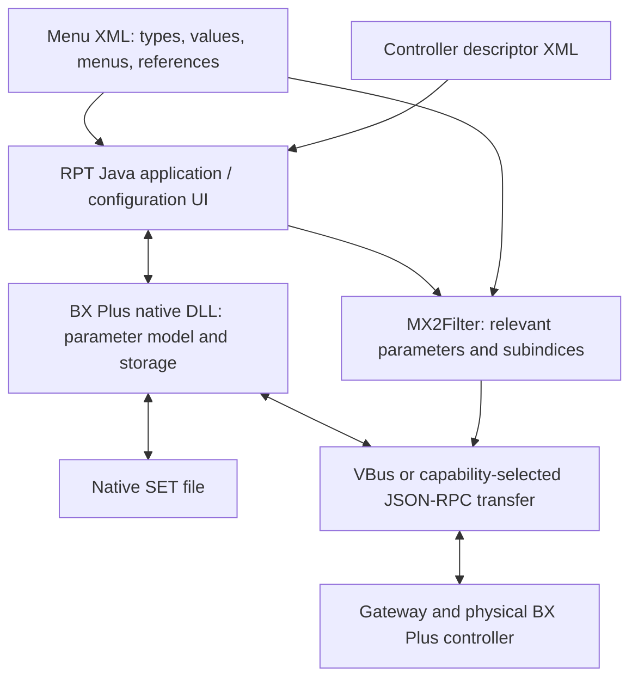
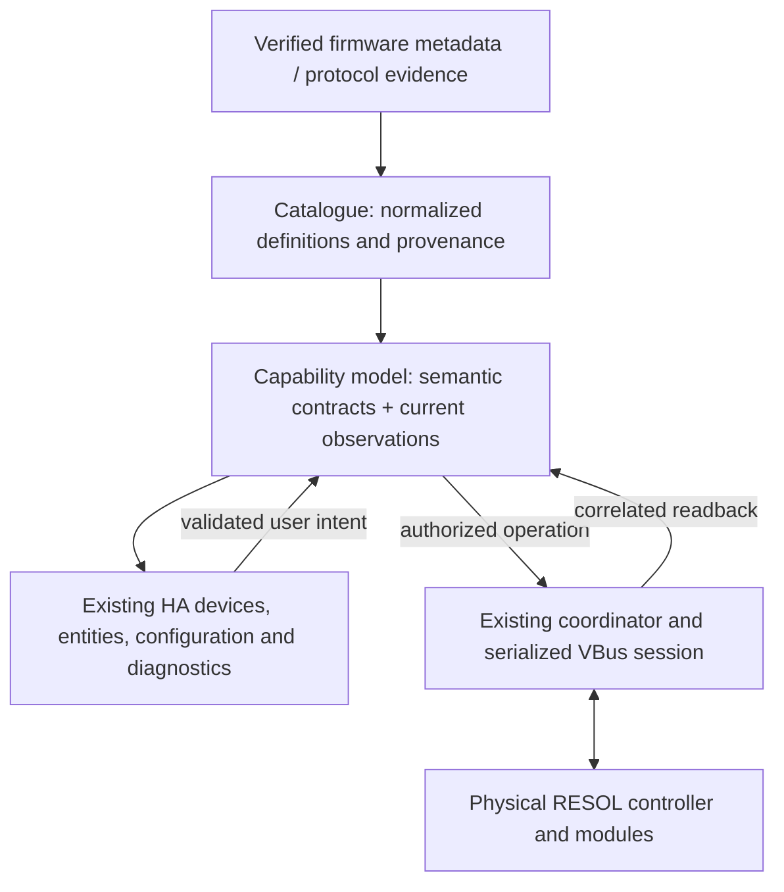

# RESOL DeltaSol BX Plus — interoperability research and integration architecture

**Research baseline:** RPT 2.02 / DeltaSol BX Plus firmware 2.08 · 28 November 2026  
**Status:** Whole-stack investigation in progress; static findings recorded, implementation and runtime qualification incomplete.  
**Implementation baseline:** [cc2ed482](https://github.com/npinguin/hass-Deltasol-KM2/commit/cc2ed482bf9e0183343bf94c4383e7593bb81a85) · [configuration scope #10](https://github.com/npinguin/hass-Deltasol-KM2/issues/10) · [development PR #18](https://github.com/npinguin/hass-Deltasol-KM2/pull/18).

## 1. Why this research matters

The original Home Assistant integration provides valuable access to RESOL telemetry through gateways such as the KM2. Reading measurements is not the same problem as understanding the configuration of the controller behind that gateway. A temperature, relay state or parameter name does not establish which equipment is installed, whether a setting is meaningful, whether it can be changed or whether a change survives a restart.

The goal of this work is a complete, maintainable configuration and operational integration for the supported BX Plus controller, rather than a collection of individually reverse-engineered controls. An owner should be able to discover the actual controller and modules, inspect their real settings and adjust supported operating parameters through native Home Assistant controls. An engineer should be able to understand unavailable capabilities, validate changes and diagnose communication failures. The controller remains responsible for autonomous operation and safety.

To get there, we investigated the entire relevant RESOL RPT-to-controller stack: the Windows installer, Java application, controller import package, menu/type definitions, native firmware-model DLL, parameter addressing, offline SET files, VBus commands and storage lifecycle. This is interoperability research at controller-system level, not merely a packet capture or a list of register addresses. It is also not a claim that every firmware routine, conditional function or physical behavior has been verified.

The upstream proposal is to reuse the existing integration and extend it with a coherent, evidence-driven configuration engine. No second application, Windows runtime, vendor DLL dependency or replacement control system is required in Home Assistant.

## 2. Research sources and method

We used three complementary kinds of evidence:

| Source | What it can establish | What it cannot establish alone |
| --- | --- | --- |
| RPT 2.02 application and BX Plus 2.08 import package | Vendor-side structure, parameter types, selection logic, native encoding and command implementation | Behavior of every deployed controller or physical persistence |
| Two genuine controller SET exports, before and after a timer configuration change | Actual storage records and differences produced by the native configuration workflow | Live VBus acknowledgement, safe write access or physical power-cycle retention |
| Existing integration, upstream protocol references and earlier field diagnostics | Current implementation, protocol conventions, actual communication symptoms and regressions | A successful end-to-end qualification of the new candidate |

The installer was extracted offline without executing it. Java bytecode and the native DLL were inspected statically; XML definitions and binary tables were compared systematically, and both SET files were parsed and compared. Native entry points and relative virtual addresses (RVAs) are recorded in the technical appendix for reproducibility. No vendor source code, binaries, private configuration files, credentials or site values are included in this document or proposed for distribution.

Evidence terminology used throughout:

- **Static verified:** a relationship is demonstrated in the examined binary, XML or file data.
- **Observed:** an actual capture or export contains the stated evidence.
- **Inferred:** a plausible interpretation still needs independent confirmation.
- **Qualified:** the implemented behavior has passed its relevant runtime acceptance test. Source tests and simulated peer behavior do not by themselves establish physical behavior.

The firmware package examined here has the same controller address and changeset as the package currently pinned by the integration, but a different archive digest. Member-level equivalence must be established before promoting the new binary findings to the existing registered catalogue trust boundary. A matching changeset is not a substitute for verifying the source.

## 3. How RESOL RPT actually works

RPT is more than a graphical editor. It loads a controller-specific package that combines a declarative description with a native implementation of the controller's parameter model. The native model is used to interpret and transfer configuration, while the Java layer manages the menu, selection and communication workflow.



The diagram is a conceptual view of the observed responsibilities, not a claim that every RPT execution path follows a single call sequence.

The descriptor identifies the controller, firmware version, changeset, native library, menu XML, parameter filter and storage format. The menu XML describes values, inherited types, units, limits, defaults, references and menu conditions. The native DLL contains parameter lookup tables, internal data representation and storage conversion. The Java application queries and transfers the appropriate values, using firmware-specific selection and capability-dependent communication paths.

The essential distinction is between **what could exist in a controller family**, **what is present in the installed configuration**, **what can currently be read**, and **what can safely be edited**. These are separate questions.

## 4. What the BX Plus investigation established

### 4.1 Controller identity and complete definition inventory

| Item | Observed result |
| --- | --- |
| Controller | RESOL DeltaSol BX Plus 2.08 |
| Controller address | `0x7112` |
| Changeset | `0x2734DABC` |
| RPT parameter filter | `MX2Filter` |
| Storage version | 3 |
| Menu XML | 15,680 value definitions; 993 menus |
| Native parameter table | 15,683 IDs |
| XML-to-native index coverage | All 15,680 XML indices found in the native table |
| Native hash/index matches | 10,649 XML entries |
| XML-only hashes | 5,031 with no native hash mapping |

Three additional native entries, 54, 57 and 58, correspond to descriptor skip-on-write IDs. Their presence is not permission to expose them as configuration controls.

The distinction between index coverage and hash coverage is important: a definition may exist at a native index without being addressable through the hash lookup. A failed hash lookup is not proof that the value cannot be read by another verified method. Equally, an index in the table is not proof of availability or write access. Discovery must report those distinctions instead of inventing values or silently excluding unknowns.

### 4.2 Types, menu conditions and dynamic configuration

The catalogue contains inherited types, display and storage scaling, enumerations, units, quantization, defaults and conditional references. The Java MX2Filter selects transfer parameters iteratively using storage classification, controlling values and, for applicable categories, explicit editable-action membership. This transfer selection is distinct from menu rendering and authorization.

Examples of selectors include:

| Family | Relevant context |
| --- | --- |
| Solar base and dedicated solar functions | Solar SystemId and native function context |
| Generic optional functions | Function Type and selected instance |
| Extension modules | Module activation and observed module identity |
| Heating circuits and functions | Circuit/function type and installed assignments |
| Heat quantity meters | Meter type and configured inputs |
| Weekly programs | Allocation, initialization and function references |

This selection mechanism explains why a flat list of every XML value is not an adequate configuration UI. It also suggests a more efficient discovery order: read controlling values first, then prioritize their dependent values, while retaining complete safe readable coverage and explicit unresolved results.

Important limitation: the RPT transfer filter is not a complete semantic permission model. In particular, a nonzero SystemId does not by itself establish a specific hydraulic topology, and the precise menu masks, compound dependencies and native assignment semantics are not yet fully reconciled. Do not infer applicability from function ordinals or write permission from menu membership.

### 4.3 Offline SET files

The two actual SET exports each contain 107 blocks of 512 bytes and 7,493 unique parameter records. All records map to native IDs; 7,492 map to XML definitions and one maps to extra native ID 54. Both files have the same key set, with 19 changed values. All 107 block-header CRCs per file were verified.

The 7,492 XML-matched stored records omit an explicit XML storage attribute. The RPT Java model initializes this category to Preferences (storage code 0), rather than unknown. These records cover the entire set of 7,492 XML values with omitted storage attributes in this archive. Preserve both the declared attribute and the effective RPT classification. Absence of that attribute is not sufficient to classify a parameter as nonpersistent or unsupported. Conversely, a parameter appearing in a SET file does not automatically establish that it is safe to write through Home Assistant.

SET files are useful independent evidence for storage layout and round-trip tests. They are not a proposed second live configuration store, and importing a full SET file into a physical controller is outside the agreed integration scope.

### 4.4 Weekly timer: from native bytes to a usable schedule

The catalogue defines 51 weekly program slots (Wsu0 through Wsu50), with seven daily payloads per slot. The native allocator actually supports 50 programs, Wsu1 through Wsu50; Wsu0 has an empty runtime lookup entry (see section 4.12). Each day contains six start/end pairs. An allocated and initialized program differs from an unallocated slot; references from functions link to programs and may not be assumed to confer exclusive ownership.

| Property | Verified representation |
| --- | --- |
| Daily payload | 12 bytes / three 32-bit words |
| Daily values | Six start/end pairs |
| Time unit | 15 minutes |
| Native range | 00:00–23:45 (0–95) |
| Unused pair | FF FF |
| Native descriptor | 0x400C for all 357 timer-day parameters |
| Word order | Successive groups of four bytes, little-endian |
| Allocation and initialization | Separate native parameters; 50 allocatable programs |

For a synthetic example, 08:00–10:00 becomes byte values 32 and 40 (hex 20 and 28). Unused trailing pairs are FF FF. This example is not a site configuration.

```text
Day bytes:  20 28 FF FF | FF FF FF FF | FF FF FF FF
Subindex:       0       |      1      |      2
Word:       0xFFFF2820  | 0xFFFFFFFF  | 0xFFFFFFFF
```

The JNI read/write routines, native SET serialization and native VBus parameter handler address the same underlying byte buffer at subindex × 4. The Java filter calculates the number of subindices from the inherited size. This is direct static evidence of the encoding, independent of plausible-looking decoded values.

**Implementation finding and correction:** the previous Python catalogue parser looked only for a child element named size, whereas this firmware's type declares size="12" as an attribute. The work branch now resolves the inherited declaration, rejects malformed/conflicting declarations and removes the unnecessary MX/SET-derived size fallback. The exact registered archive test confirms all 357 day sizes and the effective Preferences storage category; no new schedule write authorization is granted.

The static mapping is now established for the examined DLL. Full schedule ownership, live coherent reads, validated editing and failure recovery are still required before the schedule can be called delivered. No fictitious midnight sentinel or unrestricted Blob editor is needed.

### 4.5 Parameter writes, storage and bulk transactions

A controller parameter can represent a live value, volatile operating command, persistent setting or internal state. Their transport and storage behaviors are not interchangeable. The established scalar protocol distinguishes volatile write (0x0200) from write with save (0x0400), subject to a verified semantic contract.

The native BX Plus DLL also implements a multiword bulk transaction. The capability response contains the bulk-support bit 0x08. However, the word "transaction" must not be interpreted as a guarantee of database-style atomicity.

| Operation | Static native observation |
| --- | --- |
| Begin (0x1400) | Enter bulk transaction state |
| Stage (0x1500 plus subindex) | Update the underlying parameter buffer directly and mark storage dirty |
| Commit (0x1402) | End the transaction and invoke the storage lock-release/flush path |
| Expiration | Clear the transaction state; restoration of previous values was not observed |
| Rollback (0x1404/0x1405) | No corresponding branch found in the examined dispatcher or Java API |

The Java RPT transfer workflow starts bulk transfer, sends values and commits on completion. It does not establish an atomic rollback guarantee. This firmware finding contradicted the atomic staging and rollback assumption in the unused Python packed-write helper. The development branch now stops on a failed stage, precommit check or commit, reports uncertain outcome, and sends no further mutation or unsupported rollback. Negative fixtures apply a word immediately and simulate refusal/lost response; the full caller-side fresh-read reconciliation and editor remain to be implemented.

**Consequence:** a failure on the second or third word, or a lost commit acknowledgement, can leave an uncertain or partially applied configuration. Recovery must reconcile every word after regaining the session, distinguish previous, intended, partial and unavailable values, and never blindly repeat a mutation or claim successful rollback. The correct behavior of the native flush path and persistence after reconnect/restart must be qualified. Physical power-cycle retention is separate evidence.

### 4.6 Bus ownership, communication failures and relay recovery

The controller offers bus access; acquisition, address matching, request/reply correlation and release are part of the protocol, not optional housekeeping. The RPT Java implementation provides a useful reference for waiting for a fresh free-bus offer and resynchronizing after release on an authenticated connection.

Earlier field observations showed intermittent acquisition failures after manual relay override, including stale last-known modes. A previous fork correction preserves relevant release-parser evidence, but the precise physical cause of recurring offer/response failures remains unresolved. HTTP telemetry availability is not proof of VBus control availability.

The integration must serialize all operations, prioritize foreground controls over discovery, distinguish acquisition/command/release/verification failures, and never present a requested relay mode as authoritative readback. A lost response is not permission to retry a physical command. Relay recovery remains a priority regression under issues [#5](https://github.com/npinguin/hass-Deltasol-KM2/issues/5) and [#8](https://github.com/npinguin/hass-Deltasol-KM2/issues/8).

### 4.7 Detailed menu, storage and type model

Further static examination of the exact supplied XML and Java bytecode establishes the following inventory:

| Item | Count |
| --- | ---: |
| Named root types | 3,197 |
| Type nodes including inline types | 18,877 |
| Menu lines | 13,076 |
| Lines with valueRef | 8,600 (6,031 distinct values) |
| Lines with masks | 7,918 |
| Distinct comma-delimited mask tokens | 1,776 |
| Mask tokens matching a declared value ID | 204 |
| maskVal attributes | 336, all resolving to value IDs |
| extraRef / textRef lines | 1,986 / 1,767 |
| Compound value references | 3,259 |

MenuSystemInfo.LineInfo splits masks into tokens and joins compound masks with a double underscore. It resolves maskVal in global scope and extraRef in local context. Some tokens are presentation controls (e.g. Indented1), some represent access levels and some refer to native predicates (e.g. Solar_Vorhanden and Solar_WfX_IstVorhandeneFunktion). Most are not direct value IDs. Consequently a generic Boolean expression evaluator over current parameter values would not reproduce native menu visibility.

The Java menu model distinguishes an edit action (action code 3) from a value reference. MX2Filter.initEditableValueInfos selects resolved explicit edit actions. No explicit action attributes or elements were found in the supplied BX Plus menu XML; its line children are text. The generic Java edit-action mechanism therefore does not by itself prove that any particular BX Plus menu line is writable. Native callbacks and semantic contracts remain necessary evidence. Do not create write controls from valueRef, masks or labels alone.

The RPT MenuValue storage constants and exact XML counts are:

| Declared storage | Effective category | Java code | Count |
| --- | --- | ---: | ---: |
| Omitted | Preferences | 0 | 7,492 |
| volatile | Volatile | -1 | 3,123 |
| abstract | Abstract | -3 | 2,438 |
| struct | Struct | -2 | 1,915 |
| persistent | Persistent | 1 | 712 |

The Java model also defines Auto (-10). The default field initialization is zero, and parsing an explicit attribute changes that classification. The previous Python catalogue defaulted omitted storage to unspecified. The work branch preserves that legacy declared-storage value and adds the effective RPT category (rpt_storage), avoiding a checkpoint or API compatibility break. The correct normalization retains raw provenance while recognizing Preferences, without translating all preferences to persistent or granting write access.

The generic getAllStorageParameters path includes preferences and the allowParameterization flag. MX2Filter.getRelevantValueIds first excludes handled IDs and negative storage categories, then considers preference, explicit flag or positive storage with confirmed edit action, deferring unresolved selectors and excluding zero selectors. All 21 explicit allowParameterization entries in this XML belong to abstract (14) or volatile (7) categories, illustrating why a generic flag is not sufficient to authorize a transfer or mutation. The two Java selection paths have different purposes.

Compound references occur across preferences (2,744), persistent (308) and volatile (207). Preserve parent-child identity and resolve current context rather than treating the children as unrelated independent registers.

TypeInfo inherits storage and display factors (default 1), applies storage conversion with rounding, and resolves inherited limits/defaults in integer storage space. The finest quantization is the last declared level; 13 types have multiple quantization levels. Proxy types reference flow, temperature/hysteresis, power or pressure selectors. For example, temperature and hysteresis proxies share a selector; a change in presentation unit must not change native identity or reinterpret a raw value with a stale factor. The HA implementation must reject invalid user input rather than indiscriminately rounding it. Validate each selected type, scaling, limits and step against the actual resolved native representation.

**Architectural implication:** definition, applicability, readability, write authorization and storage behavior are independent attributes of one capability. A menu can display an item that is read-only; a stored value can be inactive; a volatile command can be valid without a durable representation.

### 4.8 Solar topology and optional function dependencies

The native model contains an exact topology lookup table, rather than merely a numeric SystemId interval. The Solar_SystemId parameter (index 3416) has native callbacks for interpretation and presentation. Its positive integer value decomposes into three decimal fields. The RESOL manual beginning with firmware 2.07 (pp. 20–34, dotted system notation) independently identifies the first two fields as collector-field count and store count, and the third as hydraulic variant. The native topology allocation and mask-bound callbacks corroborate this interpretation:

```text
A = (SystemId // 10000) % 100  # collector fields
B = (SystemId // 100) % 100    # stores
C = SystemId % 100            # hydraulic variant
SystemId = 10000 * A + 100 * B + C
```

The exact lookup table contains 28 eight-byte records, one of which is ID 1 (fields 0,0,1; remaining topology attributes zero). This is consistent with a no-topology record, not the value zero. The other 27 recognized IDs are:

```text
10101 20101 20102 30101 30102
10201 10202 10203 20201 20202 20203 20204 20205
30201 30202 30203 30204
10301 10302 10303 20301 20302 20304 20305
10401 10402 10403
```

The lookup validates exact combinations and supports partial selection; for example, 20304 is present but 20303 is absent. A native allocation path uses additional record attributes and the selection routine dispatches according to the decoded fields. The two counts are stored in native configuration context offsets 0x1185 and 0x1186 (allocation at RVAs 0x2cec4 and 0x2ced2). The physical meaning of all additional table bytes and exact variant-specific output allocations is not yet proven. Use actual live assignment references rather than generating fixed terminal mappings from these bytes. The menu contains up to five store slots, but the 28-record topology table has a maximum of four stores; a catalogue slot is not a supported or installed topology. Neither the XML numeric interval nor its default 10101 establishes an installed hydraulic topology. In particular, a nonzero selector used in a transfer filter is not a proof of Solar installation.

The XML defines up to three collector groups, five store groups and ten Solar relay slots. It contains 18 dedicated Solar function groups (three tube collector, three bypass, one CS bypass, three frost protection, five external heat exchanger, one target temperature, one readiness and one drainback) and 16 generic Type/Nr groups. Dedicated and generic functions must use the same capability representation, but their dependencies must be resolved from actual function identity, topology and assignments.

For instance, base collector/store sensor-number fields and base relay-number/function fields are volatile, whereas external heat exchanger function sensor and relay assignment fields include Preferences. A name ending in Nr does not establish storage or applicability. Tube collector time window/runtime/pause and external exchanger differential/runtime/target controls need function-specific applicability evidence, not a separate transport or discovery engine. Safety protection and hydraulic reconfiguration remain excluded from operational writes under the agreed scope.

The Java optional-function import postprocessor explicitly orders nonzero Type/Nr configurations as disable type, assign number, restore type. A zero type suppresses that sequence. This establishes that full RPT import can perform disruptive reconfiguration, rather than simply writing independent scalar preferences. Do not reproduce this workflow in routine HA operational edits or silently activate functions.

### 4.9 Commit, inactivity and persistence boundaries

Further inspection of the native begin/stage/commit path shows that the bulk session has an inactivity counter and an associated storage lock. Begin initializes the requested positive timeout and acquires the lock; each stage resets the inactivity counter and mutates the underlying data. Expiry clears transaction state, and no restoration of already mutated words was identified.

On commit, the native handler checks that a transaction exists, clears transaction state, triggers the lock-release path and returns success. When the last storage lock is released, dirty-store flags are scheduled for further processing. The examined return path does not wait for or verify durable physical storage. A successful commit acknowledgement is therefore not a durable-storage receipt. Further dispatcher examination found a 0x1700/1701 echo and 0x1704/1705 range-based checksum over selected native IDs/hashes/values, but no 0x1702/1703 storage-activity branch in this dispatcher. Do not assume the generic VBus storage-activity command is supported by this firmware or use a value checksum as a durable-storage acknowledgement.

The Java virtual model also has deferred storage behavior: Storage updates its buffer and schedules a worker after 2,500 ms; StorageMX uses a 5,000 ms deferred path for custom storage and a separate explicit flush path. These are observations of the Java implementation, not a timing guarantee for a deployed controller. Do not turn these delays or native counter values into a fixed physical persistence timeout.

The implementation must distinguish applied/read-back data, acknowledged completion, uncertain partial application and independently verified retention. Reconnect reconciliation must compare all affected words against previous and intended states. The independent test peer must model immediate mutation, lost responses, expiry, deferred persistence and mixed readback. No automatic replay or rollback assumption may hide an uncertain write.

### 4.10 RPT transport recovery versus the current integration

The Java TransferSerial.getValueById path uses bounded retry of a read, then release and reacquisition on the same authenticated connection, awaiting a fresh offer and verifying the expected controller source. AbstractVBusConnection.releaseBus sends 0x0600 without an explicit release acknowledgement. This is a read-recovery reference, not authorization to retry a physical write.

The current Python open_vbus establishes a fresh TCP connection; its release path sends 0x0600 and waits for the expected master's traffic, with a conditional second release only on silence. Both paths distinguish controller identity and communication state, but their connection lifecycle is different. This difference is a concrete diagnostic hypothesis for the field acquisition/release regression, not its established root cause. Compare actual offer/request/release traces before changing session lifetime or weakening address, correlation or safety checks. Preserve the single bus owner.

### 4.11 Native dynamic constraints and schedule ownership

The complete menu XML contains no explicit constraint elements, even though the native controller provides relational editing bounds. The complete index-to-descriptor join gives a useful explanation: all 15,680 XML indices point to descriptors containing two code pointers within the DLL text section, including abstract and structural entries. In the Preferences category alone (7,492 definitions), 1,757 distinct first callback addresses and 149 distinct second callback addresses are present. Callback presence is not equivalent to read/write authority; the pointer pair and data representation are separate from menu context. It does show why reproducing only XML min/max values is insufficient.

Offline inspection of the original DLL, using the sorted native parameter index table (RVA 0x183500) and descriptor pointer table (RVA 0x18afa0), joined each selected XML parameter to its 16-byte descriptor. The descriptor contains the value pointer, descriptor flags and two code pointers. The following rules are directly supported by the bound callbacks and the shared min/max helpers:

| Family | Coverage inspected | Dynamic bound | Evidence |
| --- | --- | --- | --- |
| Collector selection mask | Tube collector mask callback | (1 << configured collector count) - 1 | RVA 0x23850 reads context +0x1185 |
| Store selection mask | External exchanger mask callback | (1 << configured store count) - 1 | RVA 0x238e5 reads context +0x1186 |
| Tube collector start/end | 3/3 slots, both bounds | End >= start + 30 minutes; reciprocal start maximum | First pair RVAs 0x77687 / 0x77701, remaining pairs 0x7777b / 0x777f5 and 0x7786f / 0x778e9 |
| External exchanger on/off differential, K | 5/5 slots, both bounds | On >= off + 0.5 K | First pair RVAs 0x789dd / 0x78b1f; raw margin 5 with factor 0.1 |
| External exchanger on/off differential, R | 5/5 slots, both bounds | On >= off + 1 °R | First pair RVAs 0x78a59 / 0x78b9b; raw margin 10 with factor 0.1 |

All 13 relational pairs (26 callbacks) were compared offline: each callback references the correct opposite parameter's native index and value pointer, invokes the appropriate min/max tightening helper (RVAs 0x10cdec / 0x10ce24) and applies the expected raw offset. For tube collector time bounds the native offset is 30 in minute representation. These callbacks conditionally tighten the editing bounds based on current context. They establish a valid operational constraint, not proof that an arbitrary raw VBus write always applies the same validation.

This gives an implementation-ready pattern: bind the native family once, derive instances from verified metadata, require live assignment/activation and selected representation, check the dependent values in the same serialized operation, and reject an invalid pair before mutation. Keep the conservative conditional-write gates until the relevant function-presence evidence is established. Do not infer a 7-bit collector or 31-value store mask is valid solely from its XML maximum. The native mask callbacks demonstrate the difference between a schema capacity and the installed configuration. Do not expose topology/assignment mutations under the guise of operating parameters.

Weekly schedule ownership was also examined across the full type inheritance tree. There are 74 value definitions inheriting WochenschaltuhrNr: 16 arrangement functions and 58 heating function/circuit/room-thermostat references. All 74 are Preferences and bind to the same native callback pair (RVAs 0x549ae and 0x54a34); the first callback sets a reference interval of 0–50, consistent with XML. Each of the 51 Wsu slots contains its own Belegt allocation flag, volatile Ttl field, initialization flag and seven daily payloads. The native callback does not establish exclusive ownership or the full lifecycle of allocation/release. A range containing zero does not authorize treating Wsu0 as an ordinary user-editable allocated program. Keep the distinction between a slot, a live reference and its actual active owners. Before editing, re-read allocation, initialization, relevant references and function context; show shared ownership when observed. Do not auto-allocate or reassign a schedule merely to expose a control.

**Implementation implications:** the next V1 changes should correct the metadata parser, introduce family-based dependent constraints using the existing Setting/ConfigurationCapability model, complete the schedule editor on the corrected transport, and qualify failure recovery. Native callbacks can be studied further where a supported operation lacks evidence; it is not necessary to reimplement the controller's autonomous hydraulic algorithm or every display routine. The remaining exact menu predicate/assignment semantics and timer allocation lifecycle must not be described as solved. Retain the entire agreed functional outcome and distinguish intentionally excluded safety/commissioning operations from unfinished operational functions.

### 4.12 Native weekly-program lifecycle

The complete allocation table and its consumers were located in the supplied DLL. This resolves the difference between the 51 catalogue slots and the actual runtime pool of 50 usable programs. Offline comparison of the native table to XML descriptors established:

- Entry zero is empty (all eight bytes zero). Lookup accepts only 1–50, returning entry zero for an out-of-range reference. Wsu0 is catalogue evidence, not an editable runtime program.
- All 50 nonzero entries match both root and week structure IDs and their Monday-data and TTL pointers.
- All 51 catalogue slot layouts have a stride of 88 bytes: seven consecutive 12-byte day payloads (84 bytes), initialization at offset 85 and allocation at offset 87. The native TTL is held in a separate volatile byte array, not in the 88-byte persisted program structure.

| Native routine (RVA) | Observed behavior |
| --- | --- |
| 0x372f4 | Lookup bounded to 1–50; zero and invalid references select empty entry |
| 0x37369 | Count unallocated entries |
| 0x373c1 | Scan for first free slot; clear 88-byte structure, set allocation, initialize a template for specified reference IDs, mark storage and reset TTL; return -1 when none found |
| 0x104ac | Native UI path reads existing reference; when absent, allocates a slot, writes the resulting reference, then enters editing context |
| 0x378f4 | For a valid allocated slot, reset volatile TTL to zero; called by function/circuit paths |
| 0x37937 | Clear an allocated slot and mark storage |
| 0x379a5 | Sweep slots 1–50: clear TTL for unallocated slots; increment TTL while allocated and <=9; otherwise clear the 88-byte structure and mark storage |

The sweep is invoked by the native scheduler (call at RVA 0x35e10); the real-time duration of a sweep is not established. TTL is an aging/retention counter, not an ownership count and not a remaining-seconds measurement. The function callers refresh it by passing the stored program reference. There is no guarantee a slot remains allocated indefinitely merely because it was once observed.

Allocation is also **context-dependent**. The native routine compares 42 specific reference IDs, all verified against the 74 XML weekly references, corresponding to seven heating circuits with their five room-thermostat references. For these, it sets the initialization bit and copies a native 06:00–22:00 daily template into all seven days (remaining windows unused). The other 32 references do not enter that template branch. This is a vendor initialization rule, not an HA recommendation or a live value. The original SET pair independently demonstrates another context where an allocated, initialized program has user-entered daily values.

Implications for V1:

1. Only edit a currently allocated, initialized, positively linked nonzero program. Distinguish unavailable/expired/reallocated from an empty initialized day.
2. Reconcile active referencing functions before the mutation and all affected day words after it. A change belongs to the program itself, not to an arbitrarily chosen referencing function; if multiple owners are observed, clearly show the shared effect. Do not assume exclusivity merely because an initial capture contained one reference.
3. Revalidate allocation/reference context for every operation; if a slot has expired or changed ownership, reject stale intent. Preserve stable slot identity without confusing old content with a new allocation.
4. Creating and assigning a new program is a separate controller configuration operation with native allocation/initialization semantics. Do not invent an allocation by writing flags, copy vendor defaults into live state or manipulate TTL to keep a slot alive. Installed-program mapping remains read-only under the agreed issue #10 boundary; editing existing verified schedules remains in scope.

This is direct static evidence for the native lifecycle, not an executed physical allocation or retention test. The program-to-active-function predicates still require confirmation for each exposed context. The tests should include zero reference, a freed slot, reallocation between observation and edit, shared references, uninitialized/empty schedules, and partial or uncertain updates.

### 4.13 Registered firmware equivalence

The supplied ZIP and pinned ZIP have different container hashes. To remove the remaining evidence gap without changing runtime trust, compare the four member SHA-256 digests through the existing exact-vendor-archive developer test in CI, which already retrieves the registered archive. This is a research/source compatibility check; the pinned archive digest remains authoritative. The first comparison ([source run 46133111124](https://github.com/npinguin/hass-Deltasol-KM2/actions/runs/46133111124)) established byte-identical descriptor XML, menu XML and controller image, but a different DLL digest (registered `a5b6ecc469c65fdd45b49a1c3f1543973677720a8fcf40f1ea363c483982a71c`; supplied `2e850d5a6764488efc4405f88c1249b1bbaae1cfead416c5edc95e91873f7e43`). The full-member equality test correctly failed. Compare PE layout, image base, section flags and section content next; a different whole-file hash does not establish different executable code, nor does identical XML prove binary equivalence. The second comparison ([source run 46133236369](https://github.com/npinguin/hass-Deltasol-KM2/actions/runs/46133236369)) identified different preferred image bases: registered `0x6A880000`, supplied `0x71400000`. The supplied PE has 167,207 HIGHLOW (32-bit) relocation entries and 225 padding entries in 483 blocks. A local simulated rebase to the registered address and reverse rebase restored every original byte. The third comparison ([source run 46133357832](https://github.com/npinguin/hass-Deltasol-KM2/actions/runs/46133357832)) establishes that the images are not merely rebased copies: registered .text virtual size is 1,125,220 bytes versus supplied 1,128,404 bytes, and other section sizes differ. Therefore the relocation normalization hypothesis cannot establish equivalence. The disproven whole-image equality assertion was replaced with an exact registered-fingerprint check and independent, data-only native contract verification. The test `test_registered_native_firmware_contracts` passed in [source run 46133478024](https://github.com/npinguin/hass-Deltasol-KM2/actions/runs/46133478024) at commit `36c07e4`: 15,683 native IDs (15,680 XML IDs plus three native extras), 357 day descriptors (12-byte length and contiguous day pointers), initialization and allocation offsets, and 50 nonzero allocation records with an empty slot zero were verified directly in the registered DLL. Registered index/allocator file offsets are `0x1806a0` / `0x1214c0`; the supplied-image offsets are `0x181300` / `0x122120`. Both XML files and the image are byte-identical. This establishes cross-build structural compatibility for these contracts, not instruction-level equivalence or write authorization. All source regression and exact archive tests, Ruff, Hassfest and HACS checks passed; actual HA lifecycle and publication jobs were skipped. Do not transfer function addresses or instruction-level conclusions across builds without separate evidence. The identical XML provides exact catalogue evidence, while native implementation details remain build-specific until compared. Header and overlay differences are not ignored in the whole-file fingerprints; the registered ZIP hash remains pinned. No additional workflow, vendor binary redistribution or network runtime dependency is introduced.

### 4.14 Instruction-level cross-build verification and first corrections

The two DLLs are different builds, so structural agreement alone is insufficient for transport semantics. We inspected six address-independent instruction blocks in the supplied image and compared SHA-256 fingerprints directly against the registered executable section in the existing CI archive test. [Run 46133822341](https://github.com/npinguin/hass-Deltasol-KM2/actions/runs/46133822341) found four unique exact VBus matches; the two JNI blocks did not match byte-for-byte.

| Native code block | Supplied RVA | Registered RVA | Result |
| --- | --- | --- | --- |
| VBus scalar Blob write copy | 0x470b5 | 0x463f1 | 166 bytes identical |
| VBus Blob read copy | 0x47294 | 0x465d0 | 157 bytes identical |
| VBus bulk command selection | 0x4785d | 0x46b99 | 23 bytes identical |
| VBus bulk Blob mutation | 0x478c9 | 0x46c05 | 189 bytes identical |

The relative position of command selection and the bulk Blob loop is identical. The matched read/write loops use the same 32-bit little-endian word representation and bounds as the supplied build. The bulk loop copies directly to the native parameter pointer. Thus the relevant VBus word mapping and immediate mutation are established across both examined builds, independently of differences in the Java JNI implementation. This does not prove physical retention or authorize an arbitrary live write.

A comparison of the complete dispatcher after masking only PE-declared relocations and external CALL displacements failed in [run 46134041013](https://github.com/npinguin/hass-Deltasol-KM2/actions/runs/46134041013). It is incorrect to claim all commands are equivalent. A narrower comparison passed in [run 46134118291](https://github.com/npinguin/hass-Deltasol-KM2/actions/runs/46134118291), Python 3.13 exact archive step. It independently verifies the normalized bulk begin (242 bytes), commit (172 bytes), stage (495 bytes), actual commit storage-lock release callee (245 bytes) and actual stage dirty-store callee (77 bytes). All control-flow jumps, non-address constants and opcodes remain intact; only the PE-declared absolute addresses and known direct CALL displacements are normalized. The branches also call the same reply routine, and both dirty-store paths call the same store helper. Registered RVAs are 0x469fb, 0x46aed, 0x46b99, 0xd3b6c and 0xfa27 respectively. The 36 exact archive tests passed. The overall run failed only fixture lint (subsequently corrected), not the verified native comparison. This supports the direct-mutation and deferred-storage contract for both builds; it does not establish every other command, physical power-cycle retention or full recovery.

The first runtime corrections are confined to established contracts: inherited size and effective RPT storage in the existing catalogue (legacy storage value preserved), elimination of the inferred-size fallback, and removal of the unsupported rollback assumption in the existing packed writer. Source run [46133991208](https://github.com/npinguin/hass-Deltasol-KM2/actions/runs/46133991208) passed all source checks after the metadata changes. The new partial-write unit regressions passed on both Python versions in [46134079130](https://github.com/npinguin/hass-Deltasol-KM2/actions/runs/46134079130); that run as a whole failed the research comparison and fixture lint, so it is not a green release candidate. Continue the existing full V1 scope; no packed runtime caller or schedule editor is exposed yet.

### 4.15 Translation into native integration contracts

The work branch now binds 52 logical dedicated Solar adjustments, including 42 additional tube collector and external exchanger controls. The exact topology table and selected assignments form a common dependency check; the day-time and differential pairs use the existing numeric and relative constraint paths. The source run [46135132872](https://github.com/npinguin/hass-Deltasol-KM2/actions/runs/46135132872) passed the exact registered archive and existing source gates. Actual installed-function availability and physical operation are separate qualification evidence.

The weekly day codec is shared by discovery and configuration; it decodes exact captured words without treating a historical capture as live state. The existing typed capability model now accepts a text representation of zero to six quarter-hour intervals. The profile binds 350 usable native day definitions (50 slots, seven days), after verifying all 74 reference layouts. The native menu evidence narrows the arrangement timer owners to zone loading, heat exchange and function block (Types 3, 5 and 9), the heating optional timer to DHW heating (Type 2), and the heating circuit/room contexts to their relevant heating or sensor-mode conditions. Allocation and initialization remain mandatory; slot zero, assignment, allocation and TTL are not editable.

Regular refresh re-reads candidate program contexts using the existing selector hints; an action requires fresh resolution of all references, rejects unknown potentially active references and requires unchanged positive and active owner sets and unchanged day words. The existing serialized owner invokes the non-atomic packed primitive once, verifies reconnect readback and classifies uncertain outcomes via read-only reconciliation. No new bus owner, database, scheduler or vendor runtime dependency is introduced. A native HA Text entity is a practical editor for a whole day without inventing an external calendar or modifying individual bytes through an unrestricted service. Reference coverage during normal polling is explicitly identified as known live links; the full check is performed before mutation.

Targeted developer tests cover valid edits, no-op, invalid intervals, shared-owner changes and partial-write reconciliation; the exact archive test binds all 350 day definitions. In [source run 46135635648](https://github.com/npinguin/hass-Deltasol-KM2/actions/runs/46135635648) the Python regressions and exact archive tests succeeded; that run failed formatting only. The independent HA qualification peer now includes immediate packed mutation, committed persistence and native Text action/restart assertions, which remain unexecuted. Do not call this physical qualification or full feature completion.

### 4.16 Bounded RPT-style read resynchronization

The observed field failure after relay changes includes a response/release failure followed by intermittent fresh-connection acquisition failures. The physical cause is not established. Static inspection of RPT 2.02 TransferSerial.getValueById establishes that RPT retries a read, releases the bus and waits for another offer on the same authenticated connection, checking the master source. The existing implementation previously closed the connection after each failed operation. We retain its ordinary fresh-connection lifecycle and introduce one bounded same-connection read-only recovery attempt after a response failure with positively confirmed release. The entire refresh is restarted under a new correlated offer; partial observations and the previous grant are discarded. A failed release, failed acquisition or failed second operation is not retried in that connection. No write action or write verification is eligible, and no idle socket, second owner or scheduler is introduced.

The source regressions exercise actual VBus framing with a controlled socket fixture: read response timeout, positive release, fresh offer, successful read and second release; negative cases cover unconfirmed release and missing new offer. The health snapshot records same-connection read-resync attempts/successes separately from TCP sessions. The independent HA loopback peer also models a missing response with a surviving connection and verifies a single TCP session, positive resync count and zero writes. Actual HA execution remains pending.

Weekly ownership also now rejects indeterminate positive shared references rather than treating unknown conditions as inactive. A known false dependency is required to classify a linked owner as inactive. The regression proves an unchanged owner list with missing activity data cannot authorize mutation, while definite inactive state permits a validated no-op. Exact layout mismatches are rejected. No physical configuration was changed.

### 4.17 Heating configured operating mode versus runtime status

The exact menu XML defines seven persistent `Heizung_HeizkreisX_Betriebsart` values (index 14014 + 495 * (slot - 1)), with native ordinal IDs Automatik, Tag, Nacht, Sommer, Urlaub and Aus. The seven volatile `Betriebsstatus` values are separate runtime state, including Defekt, Frostschutz and other safety/override conditions. Their allowParameterization hint does not authorize treating those statuses as ordinary mode requests.

In every Status_Heizung_HeizkreisX menu, the uncoupled line references its own Betriebsart; the coupled line references circuit 1's Betriebsart. The supplied DLL corroborates this at RVA 0x197ad–0x197fb: it reads the coupling bit and selects either the circuit-1 preference or the local byte. All seven descriptors use flag word 0x10007; the global holiday-days descriptor (19063) is a byte with flag 0x8 and XML range 0–200. The native mode edit callback (RVA 0x7060, per-circuit wrappers 0x709c–0x7190) opens an additional native dialog on Holiday with zero days. Native runtime at RVA 0x196ed–0x19784 handles automatic transition between Holiday and Auto using the stored days and per-circuit OUrlaub flag. RVA 0xd9e00–0xd9e36 decrements the nonzero day counter and marks storage. These are supplied-build instruction-level findings; the registered-build descriptor/enum contracts are separately tested, not a claim of identical runtime instructions.

The integration now uses the existing typed Select and serialized persistent writer for configured operating mode. An active installed independent circuit gets its own control; circuit 1 is explicitly labeled as including coupled circuits. A coupled follower is not an independent write target. The shared typed requested-condition check requires actual positive remaining days before a Holiday request and rejects Auto when automatic holiday would override it. Other valid modes do not depend on an irrelevant missing holiday value. No raw runtime-status write, topology mutation or implicit holiday start is performed. The global duration is now a separate native Number contract: RVA 0x1685 reads the commissioning-completed bit (descriptor 68, native byte 0x71729b7d bit 1), and when set, opens the global day editor (19063). It proposes one day in the native UI when no duration exists. That UI default is not applied by HA: the user explicitly requests 0–200 whole days, and the exact current commissioning flag is checked before save. This is a controller-wide action potentially affecting both automatic heating vacation and Solar holiday behavior. Calendar tracking and other settings remain controller-owned. The source and independent HA tests cover explicit duration setting/cancellation and no implicit start. The independent HA peer covers save/no-op, duration setting/cancellation, coupling transitions, invalid Holiday/Auto, and restart readback; it has not yet been executed. Source regression and exact archive results are recorded in PR #18; physical effects remain separate acceptance.

### 4.18 Heating cut-off thresholds, day period and room setback

The exact menu `Heizung_HeizkreisX_Heizgrenze` references the day threshold in both native heating-limit modes (Tag/TagNacht), and the night threshold and two clock fields only in TagNacht. The assigned outdoor sensor is Sensor2_Nr (menu text Sensor Aussen). Both threshold callbacks in the supplied DLL (first circuit RVAs 0x65d88 and 0x65e8f for Celsius) set independent 0–40 °C bounds and 1-degree increments, without a counterpart constraint in the inspected edit callback. The clock callbacks (0x654a6 and 0x65540) set maximum 1425 minutes, coarse increment 60 and fine increment 15, not a derived weekly program. RPT DayTime quant step=1 is a quantization index (TypeInfo.getTypeValueQuant), not a one-minute increment. Exact selected Fahrenheit metadata is 32–104 °F in steps of 2. The implementation uses the finest established increment and existing scalar write/alias contracts; it does not impose an unproven ordering between the day/night thresholds or clock endpoints.

The room thermostat menu contains setback differential dTAbsenkung, with the native option, sensor type and weekly timer context. The first room's K/R callbacks (0x59b0b and 0x59b98) establish 1–20 K / 2–40 °R in steps of 1/2. Positive option/active/sensor-mode/sensor assignment and timer-option gates are required for the setback setting. Existing room comfort contracts now also check sensor assignment; native weekly owner resolution checks the room Option flag rather than relying on its activity field alone. All seven heating circuits and 35 room thermostats are bound by exact archive validation. No protection, activation, commissioning or assignment changes are performed.

This adds 63 logical settings (112 selected-unit/static contracts), extending the existing heating comfort family from 176 to 288 contracts. Exact source run [46138999781](https://github.com/npinguin/hass-Deltasol-KM2/actions/runs/46138999781) passed both Python regressions (142 tests, 2 archive-only skips), all 36 exact archive tests, Ruff, Hassfest and HACS. The independent HA peer has corresponding actions and restart checks, not yet executed. The existing exact archive test also reports normalized unbound native menu families as a coverage review surface. That inventory is not a list of verified writable values or a new authorization source.

### 4.19 Remaining operating menu coverage

The exact menu coverage report at ff23340 identified 3,163 menu preferences/proxies, 363 bound and 2,800 unbound in 321 normalized families. These are counts of menu references, not of safe writable controls. Remaining families include commissioning and assignment options, relay override settings already owned by relay capability discovery, historical counters, safety/diagnostic settings and additional operating controls.

The supplementary-heating menu exposes signed on/off differentials for non-On/Off modes. Supplied-build callbacks at RVAs 0xadc13/0xadd51 and 0xadc8d/0xaddcb establish reciprocal separation of 5/10 raw units (0.5 K/1 °R). Early-start and blocking callbacks 0x657a8/0x65840 establish the 300-minute maximum. Cooling clock callbacks 0x67acf/0x67b49 establish the 1425-minute maximum and 15-minute increment. The circulation pump callbacks 0x5f9a7/0x5f9e4/0x5fb14 corroborate minimum speed 20%, overrun up to 60 seconds, and idle duration 5–240 raw tenths of hours in steps of five. The existing contracts use positive option and assigned-sensor/output gates; no activation, topology or protective thresholds are changed. Exact archive test passed on run 46140044434 (36 tests); that source run failed formatting only. Both heating pump relay slots now bind their selected start and overrun duration (0–300 s) or temperature (10–90 °C / 50–194 °F); the exact native menu selects time mode 2 or temperature mode 1, and the latter requires the common assigned sensor. The supplied callbacks at RVAs 0x64f74/0x65126 and 0x64e5a/0x6500c corroborate duration and Celsius raw bounds; each relay's active installed pump type and output assignment are checked. The existing scalar/compound writer is reused; no mode or assignment changes. The independent HA peer now covers eleven representative supplemental heating, cooling, circulation and pump actions, invalid requests, dependency loss/recovery and restart; those journeys have not yet been executed. Source run 46140530071 passed 144 regressions (2 expected skips) and 36 exact archive tests; only formatting failed, corrected in 8353e8f. The updated menu coverage is 398 bound of 3163 (2765 unbound in 312 families). These are reference counts, not a write permission metric. Full operational menu reconciliation and actual HA qualification remain open.

### 4.20 Native mixer and timing callbacks — supplied archive rechecked

The owner resupplied RPT.zip, BXPLUS_2.08.zip and a private SET export. The two ZIP SHA-256 digests and all four BX Plus member digests match Appendix A exactly. The SET export contains 107 blocks of 512 bytes; all 107 six-byte header CRCs passed. No private values or vendor binaries are added to GitHub.

Direct offline descriptor-table joins and disassembly of the supplied DLL confirm the same mixer-interval callback (RVA 0x658d8, 1–20), room-factor callback (0x6867b, 1–9) and room-deviation callback (0x686cb, 1–3) for all seven heating circuits. The first mixer on/off callbacks (K: 0xaebb5/0xaecfb; R: 0xaec31/0xaed77) tighten the opposite threshold by 5/10 raw tenths; all seven instances resolve the corresponding separate callback pairs. The exact menu gives a finer 0.1 K / 0.2 °R adjustment step, so an ordinary strict inequality alone is insufficient. The runtime uses the established pair model with explicit minimum separation and positive flow-sensor/mixer-output assignment evidence.

Both heating demand minimum-runtime descriptors share callback 0x64c4b: maximum 120 and step 5, in minutes. The menu places the duration under the minimum-runtime option and provides independent relay and 0–10 V output options/assignments. The existing setting model uses mutually exclusive relay and analogue-only variants, not separate writers. All 16 function-block restart-delay descriptors share callback 0x5eb00: raw 1–1439, coarse 60 and fine 1 in minutes, not the seconds-based Time encoding used elsewhere. The exact archive reports minimum/maximum/quant 1/1439/1 and quant_step 1. Keep its enable flag and output assignment read-only.

The linear heating curve's four selected-unit endpoint callbacks (first circuit Celsius RVAs 0x6666f, 0x66789, 0x668a3, 0x669bd) set independent static limits; room-start (0x66ad7) is 20–60 °C. No reciprocal bound was observed in those edit callbacks. The native interpolation routine (0xdf2b8; 0xdf2fb–0xdf35d) subtracts the two outdoor endpoints and branches on zero at 0xdf330/0xdf334 to the first flow target at 0xdf370; the result is clamped to existing configured flow limits from 0xdf382. Both endpoint orders and equality are consequently valid; no artificial ordering constraint is added. Native configuration translation at 0x19d35–0x19df0 confirms the four endpoint offsets. Heating mode 3 (linear), 4 (room) and 5 (room influence) select these contracts. Room runtime routines 0xdea4d and 0xdeea4 traverse five room thermostats, accumulate valid active measurements, then select raw 1 = minimum, 2 = average or 3 = maximum (0xdec05/0xdec26/0xdec36 and 0xdf149/0xdf16a/0xdf17a). The factor is only relevant in mode 5. Positive room availability requires any complete enabled/active temperature-mode assigned sensor group; multiple rooms still produce one setting. The outdoor assignment is required for linear and room-influence modes. The exact menu inventory now includes verified abstract compound parents even though they carry the non-value exclusion marker; earlier counts omitted these proxies and cannot represent complete operational coverage. The corrected exact-archive developer test reports 4,462 native menu preferences/proxies, of which 1,309 have typed contracts and 3,153 (370 normalized families) remain for semantic classification. This is a review inventory, not a completion percentage or an automatic write allowlist. Remaining families include topology, activation, monitoring, commissioning, protection, historical counters and further operating functions. Full V1 remains open until this inventory is reconciled with the agreed scope and eligible operations are implemented and qualified. New operating contracts use the existing writer; exact registered archive/source tests and independent HA journeys are required. Actual HA and physical evidence remain pending.

### 4.21 Native arrangement mixer, cooling and controller logging

The supplied DLL descriptor joins for arrangement mixer target (first slot Celsius/Fahrenheit callbacks 0x5c78c / 0x5c806) establish raw upper bounds 1300 / 2660, with engineering increments 1 °C / 2 °F. The native menu lists the two assigned mixer outputs and sensor, target and interval together for Type 2. The existing selected-unit parent/child model exposes the target only in an active installed function with positive sensor and both output assignments.

The first heating circuit cooling descriptor callbacks (outdoor cutoff 0x67122, constant flow 0x67319, linear points 0x67433 / 0x6754d / 0x67667 / 0x67781 for Celsius) independently establish the exact static ranges and editing increments. Native menu predicates at 0xc9dd6 and nearby distinguish outdoor/combined cooling trigger modes 0 and 2; the cooling system menu separately distinguishes constant mode 0 and linear mode 1. These are existing configured contexts, not new controls for mode changes. Expose the six ordinary values using the existing exact unit and assignment checks. No reciprocal editor bound was identified in those callbacks; protective min/max flow temperatures and dew point remain read-only. Do not infer native runtime output from a configured endpoint.

The SD interval callback 0x6aee1 establishes raw 1–1200 in one-second increments; raw Time fields do not uniformly mean minutes (compare function-block restart delay in §4.20). SD logging method callback 0x6af8e limits raw options to 0/1, with exact menu labels Linear/Zyklisch. The native menu requires card-present/not-full; additional explicit live card-error, unknown, unformatted and write-protected status checks prevent invalid actions. Display inversion index 18260 is an ordinary Boolean preference, not a change to protection, logging files or physical outputs. No vendor input or private site values are redistributed. Exact source binding and independent HA qualification are required.

### 4.22 Native solar priority and heat-exchange hysteresis

Solar priority descriptor callback 0x235f0 uses the native configured store count at context offset 0x1186 as the maximum. All five catalogue slots share that callback; the verified BX Plus system table permits at most four stores. The priority contract checks the known multi-store SystemId, slot presence and live assigned store/collector/output plus active mode, and rejects priorities above the actual count. No uniqueness constraint was established by this callback. The exact XML static limit of five remains in the binding; the live write guard is stricter. The heat-exchange Type 5 HMinMax selected-unit callbacks 0x5d036/0x5d0c3 establish bounds 0.5–10 K / 1–20 °R and steps 0.5 K / 1 °R. Bind the 16 native parent/alias pairs only with two assigned sensors and assigned output. Solar spread-loading differential callbacks 0x6c51c/0x6c5a9 establish static ranges, but the parallel-loading-possible predicate remains to be resolved before binding that control. No raw or commissioning write is added.

### 4.23 Analogue demand and remaining-menu reconciliation

The owner-supplied BX Plus DLL descriptor table and menu directly confirm both demand slots, Type 1, active mode, enabled analogue output and output reference 1–4. The separate flow feedback option and sensor assignment gate the three feedback controls; the target offset is visible independently of feedback. First-slot native editor callbacks 0x6456f/0x645e9 (target differential, 0–200/400 raw, step 10/20), 0x64663/0x646f0 (feedback hysteresis, 5–200/10–400, step 5/10), 0x6477d (voltage correction, raw 0–10, step 1) and 0x64815 (interval 10–600, step 5) corroborate the exact XML. Voltage correction omits quant in the XML; the explicit name/scale-bound normalization is limited to those two native instances. Device characteristic (temperature/voltage endpoints), continuous voltage, feedback activation, protective flow bounds and hardware assignment are commissioning configuration, not ordinary operating adjustment. No separate writer. Independent HA peer tests and restart evidence extended, not yet executed.

The remaining menu reconciliation now uses the same exact catalogue and the existing diagnostics. An unbound menu preference is categorized as already owned by relay control, runtime/history, assignment/topology, engineering/commissioning, protection, unsupported slot, unverified manual override, hydraulic applicability, program option or unverified operating contract. These are review and write-access reasons, not claims of native immutable access. In particular, program option, hydraulic applicability, manual override and ordinary operating categories remain unresolved until positively reviewed; no activation or safety setting is promoted by a name pattern. Source test accounts for every unbound reference and reports the remaining semantic shortlist. Removed stale per-setting inspection logs from the archive test. The DrainBack XML and native descriptors confirm fill 1–30 min, recovery 1–15 min in half-minute increments, initialization 1–100 s, drain pulse delay 1–30 min and duration 1–60 s. These are not yet writable because installed hydraulic function presence and commissioning/safety implications remain unverified. No assumption from default activation or generic slot number. The remaining independent HA gate is unchanged.

### 4.24 Solar spread loading applicability resolved

The supplied XML and native descriptor table expose the exact native volatile Boolean Solar_ParallelbeladungMoeglich (3439). Its memory location is RVA 0x32a3cf, bit zero, and the native setup computes the flag (write at RVA 0x2d03d); the native menu uses this same value in its spread-loading visibility mask. Thus no inferred parallel-capable topology mapping is needed. Direct callbacks 0x6c51c/0x6c5a9 confirm 200–900/400–1800 raw and step 10/20. The existing selected-unit setting exposes the differential only with positive live eligibility, existing enabled spread-loading option (3424), collector/output assignment and at least two assigned active stores in the exact known topology. The positive pair may be stores other than 1 and 2. No automatic program changes. Archive/source tests and HA peer save/reconnect/restart and refusal when the native bit disappears are extended. HA qualification remains pending.


### 4.25 Ordinary installed-program options

The three reattached owner inputs match Appendix A's two ZIP fingerprints and all four firmware member fingerprints; the original SET export is 54,784 bytes with 107/107 valid block-header CRCs. No private SET values or vendor bytes are committed. Static descriptor and menu inspection confirms 19 native Boolean preferences: Solar pause speed (3420), pump delay (3422), spread loading (3424), and DHW loading pump overrun (11376 + 151 × slot offset, all 16 slots). All 19 use the native generic Boolean callback pair 0x4f2e8/0x4f3aa, with 0/1 limits, explicit BooleanNop menu lines and ordinary preferences storage. These are option flags, not direct pump commands or installed topology changes. Exact archive tests independently bind the corresponding menu definitions.

The Solar switches reuse the existing native assignment/loading conditions, adding exact known topology and validating the companion speed or delay before enabling. Spread loading requires the native eligibility bit, at least two active assigned stores within the actual topology, selected-unit parent/child equality and a valid differential step. The configured companion is never rewritten by toggling an option. An invalid companion blocks enable; a missing/invalid live context blocks mutation. Existing Number entities follow the option, retaining their identity.

DHW overrun requires the existing enabled loading-pump/valve flag, positively assigned loading and demand outputs in their native AktorNr namespace, primary sensor, and secondary sensor for the native Zone variant (mode 1); mode 0 is thermostatic. Switch-controlled activation requires a positive SensorSchalterNr assignment. All sixteen layouts are directly corroborated by XML and native descriptors; the duration is 1–10 minutes (first native duration callbacks 0x5ab4c/0x5ab9c). Reuse the existing serialized write/save/readback, no pump activation or assignment changes. Existing duration authorization is retained. Added focused source regressions for negative prerequisites and no-op, and independent native HA journeys for option/companion state and restart; physical operation is not asserted.

Remaining parallel-relay timing flags are also ordinary Boolean preferences, but the reference output type is RelaisOderAusgangAlleNr, distinct from the controlled AktorNr output; its callback at 0x23552 delegates to 0x517b8 and does not establish a simple numeric range. Do not guess a shared reference namespace or grant new writes until the actual reference-resolution semantics are understood. The remaining options, DrainBack and separate manual override ownership still require semantic review; no blanket scope exclusion.


### 4.26 Seasonal and circulation program options

The owner-supplied BX Plus 2.08 archive matches Appendix A. Join all selected names to their native descriptor indices (supplied DLL) and inherited XML types, storage and menu context. This identified 51 distinct ordinary preferences in eight families, including 44 Boolean flags and seven two-valued selectors. All 44 Boolean descriptors share the native callback pair 0x4f2e8/0x4f3aa; all seven heating-limit mode descriptors share 0x4ff16/0x4ffd8 (raw 0 = Tag, 1 = Tag/Nacht). The native callbacks establish 0/1 bounds; exact registered archive binding checks independently verify the storage, menu and index relationships.

| Native family | Instances | First index / stride | Required program context |
| --- | ---: | --- | --- |
| Arrangement return-flow preheat summer cut-off | 16 | 6694 / 251 | Type 8; assigned output, source, return and summer sensor |
| Heating summer cut-off enable | 7 | 13739 / 495 | Type 1, heating capable, assigned pump, flow and outdoor sensors |
| Heating cut-off Day/Day-Night mode | 7 | 13740 / 495 | Same and summer cut-off enabled |
| Heating energy saving | 7 | 14158 / 495 | Heating capable with installed pump, flow and return sensors |
| Heating automatic holiday participation | 7 | 14176 / 495 | Active installed independent circuit, valid mode, commissioning and day counter |
| Solar external exchanger target-temperature option | 5 | 4091 / 49 | Exact topology/store selection, both sensors and assigned outputs |
| Central exchanger circulation pump run-on/idle | 2 | 10647 / 10650 | Actual assigned pump and native enabled/switch-controlled activity |

The first summer cut-off menu explicitly lists Sensor3_Nr below the enable option; the day/night threshold and clock relationships are described in §4.18. For all relevant temperature/hysteresis companions the parent and selected C/F or K/R alias must agree; enable and mode-change operations validate exact raw steps and bounds, including the quarter-hour day periods when Day/Night is requested. In Day-only mode the night temperature and clock fields are not required for enabling. Energy saving also validates the configured pause/runtime (0–60 minutes each); pump idle duration requires raw 5–240 step 5 (0.5–24 h). External exchanger target temperature and modulation-rise companions use the previously established native bounds. No sensor/output assignment, native protection, preset/default or numeric companion is written by these options. All option writes reuse the same persistent serialized owner; existing numeric entities retain their native identities and conditional availability.

The per-circuit OUrlaub flag is specifically automatic entry from Auto into Holiday when the global day counter is positive: the supplied native runtime at 0x19728–0x19784 tests the flag and counter, whereas 0x196dd–0x19728 reverts Holiday to Auto only when the day count reaches zero. Disabling participation must not claim to cancel an active holiday. The integration edits only the preference, not the runtime operating mode or global counter, and uses the existing coupling boundary.

The exact archive test covers all 51 definitions and applicable dependencies; focused regressions reject invalid steps, missing assignments, wrong heating mode and unassigned switch-controlled activity. The independent HA fixture is extended with representative switches, Day/Day-Night select, no-op, companion visibility and restart assertions. Qualification remains pending until the complete V1 batch is Feature Complete. The remaining parallel reference-output resolution, schedule allocation/option lifecycle, DrainBack and separate manual overrides remain open; no blanket exclusion or scope reduction.


### 4.27 Installed thermal-function predicates

The local owner-supplied ZIP digest is the Appendix A fingerprint (385c12e6…); the exact XML/native sorted-index/descriptor-table join was repeated for all eighty option IDs. Each has preferences storage (no explicit storage attribute), a BooleanNop menu entry, and the native Boolean callback pair 0x4f2e8/0x4f3aa. Independent registered-archive tests confirm layout and type binding for each slot and both unit variants.

| Native option | First index / stride | Count | Installed conditions |
| --- | --- | ---: | --- |
| Arrangement function block thermostat A | 6705 / 251 | 16 | Type 9, assigned output and sensor 1 |
| Arrangement function block thermostat B | 6706 / 251 | 16 | Type 9, assigned output and sensor 2 |
| Arrangement function block differential | 6704 / 251 | 16 | Type 9, assigned output and source/sink sensors 3/4 |
| Arrangement solid-fuel target temperature | 6681 / 251 | 16 | Type 6, assigned pump and boiler/store/target sensors |
| Heating DHW preheat differential | 11398 / 151 | 16 | Type 3, pump, temperature and flow inputs, source/sink sensors |

The BX Plus 2.07 manual p.59 describes function-block conditions as a conjunction, with independently configured on/off thresholds and reference outputs. The earlier manual p.53 also explicitly distinguishes both thermostat orientations and disallows equal thresholds. The exact 2.08 XML defines thermostat limits −40..250°C / −40..482°F, steps 1/2; differential on 1..50 K, off 0.5..49.5 K, target 2..100 K, rise 0.5..20 K (native °R variant has doubled values and steps). The solid-fuel target channel 6682 uses 30..85°C / 86..186°F; the DHW differential uses the same on/off ranges. The selected-unit parent/child must agree, existing values must be representable, and the differential order is off < on < target (where applicable). This preserves the already authorized numeric contracts, without writes to companion settings or changes to output/sensor assignments. Switch-controlled activity requires its configured input.

A function-block predicate is not a direct relay command. Removing the last positively corroborated condition can change output logic materially; all-off runtime behavior has not been proven. Therefore disabling an enabled thermal predicate currently requires another enabled, assigned, valid thermal predicate with selected-unit mirror agreement; unchanged Off is a no-op. This is an explicit unresolved applicability gap for blocks where the remaining predicate is a timer, reference output or flow function, NOT a final exclusion. Resolve those native ownership/validity contracts before Feature Complete, including the genuine all-off behavior. A small shared peer comparison reuses the existing requested-condition checks rather than introducing a second writer or a raw service.

Independent HA fixture coverage is prepared for all five option families, save/disable/re-enable, dependent Number visibility, restart and last-predicate rejection. The actual lifecycle has not been run; complete V1 qualification is still required. Room thermostat activation/option semantics remain a separate open review: the native ActivityMode callback 0x4e2cc/0x4e3a2 establishes 0/1/2 and labels Deactivated/Activated/Switch, but does not alone establish the switch-controlled runtime relationship or whether disabling the Option flag changes ownership/allocation. The weekly timer's Boolean flag is separate from its allocation/reference lifecycle. Neither is granted write access from menu presence alone.

Reference: [BX Plus firmware 2.07 manual p.59](https://www.manualslib.com/manual/2406566/Resol-Deltasol-Bx-Plus.html?page=59) and [earlier manual p.53](https://www.manualslib.com/manual/1625333/Resol-Deltasol-Bx-Plus.html?page=53); exact firmware layout and encoding remain grounded in the supplied DLL/XML.

### 4.28 Existing weekly programs and heating/solar coordination

The supplied BX Plus 2.08 ZIP was verified locally against Appendix A. Joining all native descriptor IDs to the XML and menu references confirms the 74 existing timer flags (16 arrangement, 16 DHW, 7 heating circuits and 35 room thermostats). Each has the Boolean callback pair 0x4f2e8/0x4f3aa; each corresponding program reference has 0x549ae/0x54a34. The menu extraRef links the flag and reference. The 50 program layouts remain the ones established in §4.12. Native TTL refresh 0x378f4 is called from arrangement, heating function and heating circuit/room reference processing; this does not guarantee indefinite retention of an unused program.

Enable only an existing positively identified, allocated, initialized program, with all seven native day values decoded successfully. Read the current reference again around the packed reads. Reject a changed reference, expired allocation or invalid day; persist the flag alone through the existing writer. Disable preserves the day values and reference. Weekly editor availability is reconciled after the change; a valid enabled timer is now a corroborated alternative function-block predicate, closing that part of §4.27. Allocation, assignment, copying, TTL manipulation, reference-output/flow predicates, genuine all-off behavior and room thermostat activation/option semantics remain separate unresolved review items. No physical retention or actual HA lifecycle evidence is claimed.

The same XML/native join confirms 99 further preferences with the same Boolean callback pair. Native first indices and strides are:

| Option | First index / stride | Count |
| --- | --- | ---: |
| Heating start optimization | 13714 / 495 | 7 |
| Heating stop optimization | 13716 / 495 | 7 |
| Cooling daily timer | 14098 / 495 | 7 |
| DHW holiday off | 11281 / 151 | 16 |
| DHW solar off and Tset condition | 11282, 11284 / 151 | 32 |
| Heating supplementary solar off and Tset condition | 14141, 14143 / 495 | 14 |
| Solar backup suppression Tset condition | 4462 / 120 | 16 |

The existing assigned input/output and function mode guards remain authoritative. Enable start/stop optimization only with a valid 0–300 minute companion; cooling uses the existing quarter-hour daily clocks. Solar off uses a positive native store mask within the configured system topology. The Tset condition additionally requires the selected store target/maximum values to match their selected-unit aliases, with target <= maximum and the existing 4–95°C or 40–204°F bounds/steps. Disabling a parent preserves the subordinate preference and hides its control until applicable again. This adds no wiring, sensor assignment, safety override, second writer or raw service. Source tests verify exact layouts and guard behavior; actual HA fixture journeys are prepared but not yet executed.


## 4.29 Installed operating selectors and external input options

Exact BX Plus 2.08 XML and native descriptors corroborate the following additional operating preferences (65 distinct names, 91 typed variants):

| Family | First index / stride | Count |
| --- | --- | ---: |
| DHW thermostat / zone mode | 11378 / 151 | 16 |
| DHW operating-mode switch off option | 11287 / 151 | 16 |
| DHW manual heating input option | 11387 / 151 | 16 |
| Heating circuit weekly day/night or day/off mode | 13704 / 495 | 7 |
| Heating circuit cooling outdoor / external / both mode | 14066 / 495 | 7 |
| Solar collector minimum temperature option | 3533 / 14 | 3 |

Use the existing persistent writer and requested-mode conditions. DHW mode requires assigned demand output, primary sensor, configured pump output when applicable, and ordered selected-unit threshold mirrors; zone mode additionally requires the secondary sensor. The external-input flags require assigned native input references and do not manipulate input state or directly command heat. Heating timer mode requires an allocated initialized week and valid day payloads, plus valid night correction for day/night. Cooling mode checks the appropriate outdoor threshold and/or assigned external input. Collector minimum enable requires a compatible installed system, assigned collector and solar output, and existing valid minimum threshold. Preserve topology, safety limits, input assignments, settings and history.

The earlier reference-output investigation is narrowed by native callback helper 0x258fc: it splits the reference into a low-byte number and high-byte kind; high byte 1 or legacy positive high byte 0 identifies relay, high byte 2 identifies analogue output, other kinds return no reference. Reverse helper 0x2596f constructs kind 1 or 2. This is not yet proof of the complete installed output-number namespace or permission to control a referenced output. Solid-fuel selection callbacks 0x2397a/0x23a21 enumerate active native records and use a record-specific ordinal for the selection bit; a simple assumption that every mask bit is an arrangement slot is not justified. Both remain open along with room thermostat activation, type-specific activity and protection semantics, weekly allocation, and remaining operational modes.

The exact firmware and developer source tests corroborate the 65 bindings; actual HA lifecycle and physical behavior are not yet qualified. The larger numerical target is not an acceptance criterion that permits speculative writes.

## 4.30 Installed room thermostat activation and thermal operating modes

The 2.08 exact catalogue and native callbacks distinguish a configured room thermostat Option, its activity byte, and its sensor type. The activity callback pair (0x4e2cc/0x4e3a2) uses the generic ActivityMode enumeration 0/1/2. The room structure has separate temperature/switch sensor references (first room indices 13834/13838), but no distinct activity-switch input. The documented temporary activation journey has two states and retains settings (RESOL DeltaSol BX Plus manual, room thermostat section). The installed heating/combined circuit contract exposes Deactivated/Activated only; observed mode 2 is not normalized to either state and remains unresolved. The Option flag and sensor/output allocation are unchanged. The cooling-only case still requires specific runtime evidence. Room-controlled flow modes must retain at least one active valid sensor room. An active room timer requires an allocated, initialized week with valid packed days; a changed activity invalidates affected shared weekly editors before refresh.

Added contracts (85 distinct parameters, 117 selected-unit variants):

- 35 room activation selectors and seven HC-off preferences.
- Seven supplementary-heating modes (thermostat/zone/on-off; native callbacks 0x656b7/0x6578d). Temperature-based modes require the assigned sensors and ordered differential thresholds; on/off does not require an unused temperature threshold.
- Four shared pump start/run-on mode selectors (none/temperature/time; native callbacks 0x503b5/0x5048b). Validate only requested-mode dependencies.
- 32 DHW preheating target and hysteresis settings (16 installed slots each, TMax 20–90 °C or 68–194 °F; dTMax 0.5–10 K or 1–20 R). The manual's DHW preheat section describes these as pump speed regulation, not a potable-water safety limit. Require flow/temperature/pump assignment and validate configured optional valve/differential references.

Reference-output research: 0x258fc decodes the reference kind and number; 0x231f9 and its table distinguish local relay and extension-module ranges, and 0x23474 resolves analog outputs. The separate actor registry (0x10f72/0xb8113) resolves an AktorNr to a dynamic record; 0x12101 uses record relay/analog fields for labels. It is therefore not correct to compare a raw AktorNr to a reference relay number to detect self-reference or dependencies. The function-block reference-mode catalogue has OR/AND/NOR/NAND; actual reference status and ordering/ownership still need proof before enabling the reference-dependent writes. No broad actor ID alias or raw write fallback has been added.

Exact archive and targeted source regression tests corroborate the bindings. Independent HA peer cases have been extended; actual HA lifecycle and physical acceptance remain NOT_RUN. General activation, RTH mode 2/Option, cooling-only room applicability, reference-output/flow predicates, weekly allocation and remaining hydraulic/override semantics stay in the full 1.2.17 scope.

## 4.31 Callback-first reverse engineering of remaining native families

On 2026-11-28, rejoined the complete pending semantic review from successful exact-head source run [46151243087](https://github.com/npinguin/hass-Deltasol-KM2/actions/runs/46151243087), commit f1b4e605, to the owner-supplied 2.08 ZIP (SHA256 385c12e6646c3aeb2efe45c24dd6b7b6f46fb179724408f24090bc44765f5b9e). Used the existing XML menu preference/proxy inventory, the same normalization rule (digits following a nondigit become X), and the native sorted-index and descriptor tables in §4.11. Excluded compound children; matched the exact pending list count, 388 names in 64 families. No vendor bytes or private SET values are committed.

| Supplied-build native callback pair (RVA) | Parameters | Review implication |
| --- | ---: | --- |
| 0x4f2e8 / 0x4f3aa | 235 | Generic Boolean editor, 24 families; classify semantic context separately |
| 0x4e2cc / 0x4e3a2 | 85 | Generic ActivityMode editor, 14 families; installation and transition semantics |
| 0x5e9fb / 0x5eae5 | 16 | Function-block reference logic |
| 0x55c17 / 0x55c7a | 10 | Solar standby/holiday priority |
| 0x53f9b / 0x5402a | 7 | Solar standby/holiday temperature parents |
| 0x66e63 / 0x66f39 | 7 | Heating remote-access mode |
| 0x50817 / 0x508a6 | 4 | Solar standby/holiday cooling differential parents |
| 0x252ba, 0x25333, 0x25367, 0x2539b / 0x4f78c | 10 | Four manual override owner classes |
| Six activity wrappers / 0x4e3a2 | 6 | Demand/pump/valve instance-specific editor and change callbacks |
| Eight other single-instance pairs | 8 | Loading, holiday mode and DrainBack |
| **Total** | **388** | **25 distinct pairs; 61/64 families (382 parameters) share a single exact pair within each family** |

The two generic pairs cover 320/388 (82.5%). This is editor-code compression, not proof of equivalent runtime behavior, access rights or completed scope. The six activity exceptions are important: demand wrappers 0xa0adf/0xa0e65 call 0x63e29, pump wrappers 0xa11eb/0xa12b3 call 0x64e1d, valve wrappers 0xa137b/0xa13af call 0x6527e. Each helper calls generic ActivityMode editor 0x4e2cc then passes 1 to upper-bound helper 0x10cdbe (writes context +0x20 and +0x10). Thus these six editor contexts restrict the upper bound to 1, despite their shared ActivityMode type. Each wrapper also installs a different change callback in editor context +0x5c (0x7259, 0x7287, 0x76e3, 0x7711, 0x780a, 0x7838). These compare old/new and call the respective demand/pump/valve-specific routines with the instance number and new value. Do not assume raw VBus writes invoke these UI change callbacks or reproduce their effects. Investigate runtime/write path before permission; common encoding alone does not authorize mode 2 or hardware allocation.

Native index stride and storage pointer stride are independent, but both are repetitive. Spot-checked first two instance activity descriptors: arrangement index +251 / pointer +204 bytes; solar optional +120 / +60 bytes; heating optional +151 / +88 bytes; heating circuit +495 / +314 bytes; HQM +133 / +28 bytes. Room thermostat Option uses index +32 within a circuit and +495 between corresponding rooms in successive circuits, first two pointers +20 bytes. Same callback can also use different descriptor flag words (room Option 0xffff versus parallel relay ONachlauf 0xfffd). Never derive bit layout or physical actor identity from index stride alone.

Next investigation should operate on the existing evidence at three levels: (1) shared editor/encoding/limits by callback pair and type; (2) instance layout by exact indices, pointer/flags, menu membership and actual owning Type; (3) semantic runtime paths: read/write cross-references to the target storage byte/bit, transition callbacks and referenced actor/sensor/program registries. Normalize relocated code references for comparison across supplied and registered builds, but preserve callback wrappers, bound instance constants, descriptor flags and dependency identities. For each proven mechanism expand all exact instances using existing Setting, Dependency, AnyDependencies, PeerComparison, WeeklyProgram and requested-condition helpers; exact archive binding and developer tests for all instances, representative positive/negative transitions in independent HA peer. Do not add a second runtime catalogue, generic raw writer or new governance. An offline audit can be incorporated into the existing exact archive test if needed, rather than a separate production parser.

Prioritize common dependency bottlenecks: ActivityMode runtime transitions (91 including six special wrappers, one belongs to DrainBack); reference actor resolution (32 parallel relay timing flags + 32 function-block reference enable/mode flags); allocated room/option lifecycle (35 room flags); solid fuel and hydraulic/assignment-dependent option groups; then standby/holiday and isolated overrides. These are research surfaces, not commitments to grant write permission to every member. Existing numeric contracts and all 388 pending reviews remain unchanged by this analysis. Actual HA qualification remains pending until complete agreed V1 scope.

## 4.32 Shared activity runtime evaluator and first installed-context expansion

The supplied DLL routine RVA 0x10e8c (150 bytes, through return at 0x10f21) establishes the common activity evaluation independently of the editor callback. It receives a two-byte configuration pointer and a separate presence argument. Absent returns status 6; present mode 0 returns 9, mode 1 returns 10, and mode 2 requires a nonzero signed switch reference, resolves it through 0x25ba1, and returns 10 only if the resolved runtime sensor state's bit 0 is set, otherwise 9. Unknown modes also return 9. In the supplied disassembly 34 direct CALL sites use this routine. Several callers compare the result to 10 and write the resulting Boolean into the function's working state (e.g. 0x131f2, 0x1979b, 0x36321); the pulse accumulation path at 0x36cb5 also branches on it. Thus this is not merely a label formatter. This evidence does not establish every caller's full transition consequences.

The registered-build exact archive test independently finds the entire evaluator at RVA 0x10214. Normalization zeros only the four-byte relative CALL displacement at body offset 0x5c (opcode offset 0x5b); SHA256 7abb4b99cbd75f3c497e17444b38044bfffa1bbd43399e0207b464c54ee43795. All 55 new activity parameter descriptors in that build share the same callback pair, flags 7, and a mode-byte pointer exactly one byte after the corresponding activity-switch assignment. This verifies the shared mechanism across the two distinct images without transferring their absolute callback addresses. Source run 46152147173 passed 164 developer tests (2 expected skips), 36 exact archive tests including this fingerprint, Hassfest and HACS; formatting was the remaining source-gate failure on that revision.

The common typed Select uses the existing writer, exact Type context and requested-condition model. The 55 distinct names/142 context variants are:
- Arrangement 16 names, installed Type 2 mixer, 3 boiler loading and 5 heat exchange (48 variants).
- Heating optional 16 names, Type 2 DHW, 3 preheat, 4 thermal circulation variant 0 (48 variants).
- Solar optional 16 names, Type 6 backup suppression and 7 parallel loading relay (32 variants).
- HQM seven names, Type 1 measured-flow without reference relay, Type 2 impulse counter (14 variants). Activity remains controller-owned even if the telemetry meter disappears, while existing HQM display entities retain their device ownership.

Activation validates assigned inputs/outputs, applicable selected-unit temperature companions and ordering, and an initialized valid weekly program if enabled. External-switch mode additionally needs the existing assigned switch. Deactivation writes only the native mode; it does not write Type, output assignments, references, history, or companion preferences. No-op and dependency refresh use the existing coordinator. Actual HA mode transition cases are prepared, not executed. Physical retention, sensor state and actuation remain separate evidence.

Coverage caveat: the name-based exact inventory now reports 1,927 bound of 4,462 and 333 remaining pending unbound names (291 program, 24 operating, 8 DrainBack, 10 manual). The 55 newly bound names are **not fully closed across all Type contexts**. Other arrangement types (including reference-dependent functions, solid fuel, error and flow protection), other heating contexts (including disinfection and circulation variants 1–4 with timer/assignment lifecycle), other solar generic types, estimated-flow/reference-relay HQM, dedicated solar, store/circuit/supplementary modes and the six special editor transition wrappers still require separate semantic review. The existing weekly-owner model currently covers heating optional Type 2 only; the circulation menu exposes a separate timer path through its variant selection, so investigate its actual use of the same native reference before granting circulation schedule-related activity. Do not infer those contexts from the shared evaluator or drop them from V1 acceptance.

## 4.33 Circulation weekly ownership: native variant predicate

The supplied 2.08 menu defines circulation variants 0 thermal, 1 timer, 2 thermal plus timer, 3 demand, 4 demand plus timer. The Type 4 menu links the same `Heizung_WfX_SchaltuhrNr` preference as Type 2 DHW; in slot 1 the reference is index 11346 and variant is index 11405 (both stride 151). The generic `OSchaltuhr` at 11288 is a separate native preference. The supplied DLL runtime at RVA 0x1f013 reads variant at record offset 0x51, establishes the timer flag for exactly 1, 2 and 4 at 0x1f06b–0x1f092 and calls the weekly evaluator 0x37aec at 0x1f1d1 with the reference at record offset 0x4b. Its activity call at 0x1f1a1 uses the shared evaluator; TTL refresh at 0x1f006 also reads that reference. The native weekly lookup at 0x37a5c checks allocation. This corroborates the menu and reference layout, not physical operation.

The existing weekly owner now has an alternative context for each of the sixteen heating functions, rather than creating duplicate owners or new controls. Type 2 retains its original activity and timer-flag predicate; Type 4 uses activity and the timed variant. A known false condition must disprove both alternatives before classifying the owner as inactive; missing variant data cannot authorize a shared edit. Full live read checks both contexts and preserves all 74 reference identities. The existing timer-flag generator remains Type 2 only. Targeted source regression exercises all five variants, unknown variant, stale active ownership, no-op and unchanged identity in the existing shared-day test. This is an ownership correction, not authorization for changing the circulation variant, allocating a program or enabling new activity contexts. Those contracts and full HA qualification remain open.

## 5. Architecture: a single native Home Assistant integration

The proposed implementation direction builds on the existing Python components instead of importing RPT into Home Assistant. The native controller remains the authority for actual configuration, telemetry and physical control. RPT and other verified sources provide evidence for how to interpret those capabilities.



These are responsibility boundaries in the existing implementation, not a proposal for additional services or a new framework.

| Responsibility | Existing code to reuse | Direction |
| --- | --- | --- |
| Source validation and catalogue | [catalog.py](../custom_components/deltasol/catalog.py) | Exact identity, digest and inherited metadata; preserve provenance and conflicting definitions |
| Controller and relay profiles | [parameters.py](../custom_components/deltasol/parameters.py) | Verified semantic contracts, actual module identity and stable capability keys |
| Discovery and snapshots | [discovery.py](../custom_components/deltasol/discovery.py) | Bounded resumable reads, selector-aware ordering, explicit unknowns, complete safe coverage and packed values |
| Configuration policy | [configuration.py](../custom_components/deltasol/configuration.py) | Type, range, scaling, installed dependencies and write authorization; one model |
| Native HA projection | [configuration_entity.py](../custom_components/deltasol/configuration_entity.py) and existing HA platforms | Native controls and accurate availability; preserve existing identifiers and history |
| Communication and ownership | [deltasolapi.py](../custom_components/deltasol/deltasolapi.py), [vbus.py](../custom_components/deltasol/vbus.py) | One serialized owner, exact request/readback correlation, real partial-write and recovery semantics |
| Diagnostics and regression | [diagnostics.py](../custom_components/deltasol/diagnostics.py), [tests](../tests/) | Truthful evidence, redaction, lifecycle and backward compatibility |

A capability is not simply a register. It has a stable semantic identity, source controller/module, applicable type, constraints, current observation, access and storage semantics, and a verified operation where applicable. The same capability is used for discovery, diagnostics and native HA projection. Its identity must not depend on a catalogue digest, provider name, transient parameter index or changing display label.

Definitions can come from more than one source in the future. Live observations and write authorization remain separate from descriptive metadata. Unknown, unavailable, refused, stale and conflicting are legitimate states, not zero values or defaults. Do not create a second cache, discovery service, writer or user-facing generic register API.

Safety-critical protection settings, hydraulic topology, credentials and unsupported operations remain read-only or excluded as appropriate. Existing autonomous controller safety and configuration are not replaced by HA. This is a real product boundary, not a justification to omit verified in-scope operational controls.

## 6. Implementation direction for V1

The approved functional scope remains DS-PAR-01–05 in issue #10. The table below describes how the research changes the implementation approach, not a new requirement register.

| Step | Required outcome | Acceptance evidence |
| --- | --- | --- |
| Reconcile evidence | Match the pinned and supplied archive members; finish native menu, storage and dependency analysis | Exact artifact fingerprints, reproducible mappings, explicit unresolved cases |
| Correct catalogue | Read size attributes and inheritance consistently with RPT; retain genuine metadata provenance | Exact archive tests for all 357 daily definitions, storage default, inherited scaling/quantization, conflicting and malformed declarations, no unverified write grants |
| Complete discovery | Prioritize selectors, exact topology and installed assignments, preserve full safe readable inventory, distinguish unresolved values | Native IDs, live applicability, bounded interruption/resume and snapshot comparison |
| Correct transport | Remove false atomicity assumptions; reconcile partial or uncertain writes and relay acquisition/release | Independent peer applies words immediately; stage failure, lost commit, reconnect, stale values and no blind retry |
| Complete native configuration | Verified schedule read/edit, relevant operating parameters and conditional Solar/heating/module functions | Live dependencies, 3 tube collector pairs and 10 exchanger unit-specific pairs, schedule ownership, native actions, exact readback and persistence; no duplicate writer |
| Qualify the full batch | Preserve existing 1.2.16 functionality and complete the agreed 1.2.17 scope | Exact candidate source gates, actual isolated HA lifecycle, actions, recovery, upgrade, restart and exact predecessor rollback |

The weekly editor must use the existing owner, validate complete days and ownership before any mutation and report the authoritative final state. A partial write is not success. A recovered state that differs from both the original and requested schedule requires explicit reconciliation; the UI must not hide the discrepancy. No new HA UI framework is required: select the smallest native HA surface that provides a genuinely usable schedule editing journey, and verify it end to end.

The order above does not authorize new feature implementation before the outstanding RPT analysis is sufficiently resolved. Keep the existing development batch and scope. Do not publish an incomplete TEST merely because the source checks pass.

## 7. Future support and upstream contribution

### V2: build on the same model

A future version can investigate RESOL's open-source protocol tooling (including resol-vbus-core) and other independently verified catalogues to broaden controller and firmware support. That is an extension of the same capability model and communication owner, not a second runtime or mandatory new dependency. The current V1 catalogue is firmware-specific; it does not prove generic support for all BX, MX or other controller variants.

Before enabling a new controller, identify its actual address and changeset, compare source provenance and conflicts, verify address/encoding/storage rules and test its semantic operations. Keep existing IDs, history, settings and offline local operation intact. Unknown firmware must degrade gracefully without disrupting telemetry or other independently supported capabilities.

### What makes this upstream-worthy

The intended contribution is an understandable and maintainable integration improvement backed by whole-stack research. It should be possible for an upstream maintainer to review the model, protocol assumptions, failure behavior and tests without using RPT or needing the original research environment. The existing upstream telemetry and supported gateway behavior must remain intact.

The contribution should explain what was learned, what code is reused, which existing assumptions were corrected and how each new capability is tested. Separate research facts, implementation changes and qualification results. Review license and redistribution rights before any third-party source, metadata or binary is included. This document describes independently established interoperability facts and contains no vendor binary, decompiled routine listing or private SET export. It does not assert a legal right to redistribute vendor material.

No upstream PR is submitted by this research document. Upstream review should follow completion and qualification of the agreed functional scope, with an appropriate reviewable change set and clear compatibility limitations.

## 8. Open research and proof boundaries

| Topic | Current conclusion | Evidence still needed |
| --- | --- | --- |
| Archive identity | Distinct DLL builds; identical XML/image; exact registered SHA, structural and relevant bulk instruction contracts verified | Remaining native function/relay predicates where required |
| Weekly mapping | Structure and VBus word-copy instructions verified in both builds; 50 usable programs | Native owner/menu gates and editor implemented; isolated HA and physical evidence pending |
| Bulk recovery | Native begin/stage/commit and storage helpers verified across both builds; direct mutation contradicts assumed rollback | Caller-side reconciliation implemented; independent HA and field recovery qualification pending |
| Persistent storage | Preference defaults and native deferred storage path identified; commit is not a durability receipt | Complete restart/reconnect proof, physical retention separately |
| Solar/menu applicability | Native SystemId decomposition, counts and 28-record lookup verified; dynamic mask bounds and 13 paired constraints confirmed; menu and transfer selection separated | Remaining variant/assignment attributes, native presence predicates and all applicable function contracts |
| Relay stability | RPT read recovery and Python session lifecycle compared | Actual recovery root cause and qualified regressions; supervised site acceptance separately |
| Overall product | Active development, not feature complete | Full DS-PAR-01–05 and applicable DS-REL journeys, exact qualified HACS bytes |

At the audited source baseline, source CI passed; actual HA candidate qualification and publication were skipped because the PR was Draft ([pipeline](https://github.com/npinguin/hass-Deltasol-KM2/actions/runs/46130468050)). The last published TEST reported in the existing batch is 1.2.16. This document neither changes runtime code nor claims that the next release is complete.

## Appendix A — Reproducibility references

The following fingerprints identify the exact examined research inputs; the SET exports remain private.

| Artifact | SHA-256 |
| --- | --- |
| RPT ZIP (owner-supplied) | `23ae2e946848e78fb5a8e64f890379a595561a2d511c4b5a004b8ea0deec8974` |
| Extracted RPT Java archive | `f3415c06e8118572c7a5ccdb17ed2411f4719b439d4149282a455d58b3d581dd` |
| BXPLUS_2.08 ZIP (owner-supplied) | `385c12e6646c3aeb2efe45c24dd6b7b6f46fb179724408f24090bc44765f5b9e` |
| BX Plus DLL | `2e850d5a6764488efc4405f88c1249b1bbaae1cfead416c5edc95e91873f7e43` |
| bxplus_208.xml | `dcd82d53056e78b8a26209b9b4012f3b3787d12e2f835bf270cc7b616968ccd3` |
| BXPlus_208-Menu.xml | `5311e1a5c2da8fe606c8dc49093202e6607d93e1b51430e84a93d4a56ec6e60e` |
| Resol_BXPlus.png | `e70397a53ff8f09d79af19cb431e9f1b65e83af6f5cd4aafe35441e6bf3ee9c2` |
| Existing registered firmware archive | `1bcc59cac3d4176c68de255fced3b95840bada06db33b0bdae0cddb007a9f079` |

Native DLL RVAs below are inspection references, not portable entry points or a public API.

| Evidence | RVA / Java reference |
| --- | --- |
| Sorted parameter lookup and native hash tables | 0xb7673, 0xb778b, 0xb77d0 |
| JNI parameter read/write | nativeGetValuesById 0x7d79; nativeSetValuesById 0x7f88 |
| Storage byte serialization | 0xfe599, 0xfe4fa |
| VBus parameter handler | 0x4700f |
| Bulk begin / direct stage / commit | 0x476bf / 0x4785d / 0x477b1 |
| Storage dirty / lock-release and flush path | 0x1069f / 0xd4848 |
| Bulk expiration | 0x4d6f0 |
| Echo / range checksum dispatcher | 0x47657 / 0x47a4c |
| Native storage lock / deferred store scheduling | 0xd47c1 / 0xd4848 / 0x100d2c |
| Solar SystemId descriptor / callback | 0x150d18 / 0x23e7b |
| Solar SystemId split / recomposition | 0x23c60 / 0x23d2f |
| Solar topology table / exact and partial lookup | 0x123520 / 0x25c79 / 0x25ce0 |
| Native topology selection / attribute access | 0x2611c / 0x23d4a / 0x01c04 |
| Java menu and storage model | MenuSystemInfo.LineInfo, MenuValue, TypeInfo |
| Java transfer selection and import order | MX2Filter.initEditableValueInfos, getRelevantValueIds, postProcessOptionalFunctions |
| Java deferred storage model | Storage.writeStorage, StorageMX.writeStorage |
| Java read recovery | TransferSerial.getValueById |
| Native index / descriptor pointer tables | 0x183500 / 0x18afa0 |
| Configured collector/store counts | Allocation 0x2cec4 / 0x2ced2; context offsets 0x1185 / 0x1186 |
| Dynamic min / max helpers | 0x10cdec / 0x10ce24 |
| Weekly reference callback pair | 0x549ae / 0x54a34 (all 74) |
| Weekly allocation lookup table / lookup | 0x124320 / 0x372f4 |
| Weekly free count / allocator / UI entry | 0x37369 / 0x373c1 / 0x104ac |
| Weekly TTL refresh / clear / sweep | 0x378f4 / 0x37937 / 0x379a5 |
| Weekly native heating template | 0x1244b8; 42 verified reference IDs |
| Parameter selection and packed IDs | MX2Filter.getRelevantValueIndices |
| Java transfer lifecycle | Controller.readDataFromLibrary, writeDataToDevice, Controller$7 |
| Bus acquisition / release | AbstractVBusConnection.waitForFreeBus, releaseBus |

SET file block-header CRC verification used reflected CRC16 polynomial 0x8408, initial and final XOR value FFFF, over the six-byte block header. This is a description of the observed format, not a general guarantee of whole-file integrity.

### References

- [RESOL DeltaSol BX Plus operating and installation manual, document 11202383](https://www.resol.de/Produktdokumente/Alte_Montageanleitungen/11202383_DeltaSol_BX_Plus.monen.pdf) — operating function definitions and native timer range.
- [RESOL DeltaSol BX Plus manual beginning with firmware 2.07](https://www.manualslib.com/manual/2406566/Resol-Deltasol-Bx-Plus.html) — pp. 20–34, dotted system numbers and output/sensor allocation. The older manual's ordinal system numbers must not be used as exact 2.08 SystemId mappings. The online table of contents was accessible; individual page retrieval failed, so the binary remains the authority for the exact 28-record list and dynamic bounds.
- [RESOL VBus Core parameterization guide](https://resol-vbus-core.bugstu.be/guides/vbus-parameterization.html) — independent protocol/mapping reference; not proof of BX Plus-specific storage behavior.
- [Original RPT binary audit evidence](https://github.com/npinguin/hass-Deltasol-KM2/pull/18#issuecomment-7237378673) — native analysis, source fingerprints and limitations.
- [Configuration scope and acceptance](https://github.com/npinguin/hass-Deltasol-KM2/issues/10) — authoritative work scope.
- [Active development and qualification record](https://github.com/npinguin/hass-Deltasol-KM2/pull/18) — current implementation and remaining work.

Maintain this research note when new evidence changes a conclusion. Keep actual work status and release decisions in the existing issue and PR, rather than turning this note into another project tracker.
