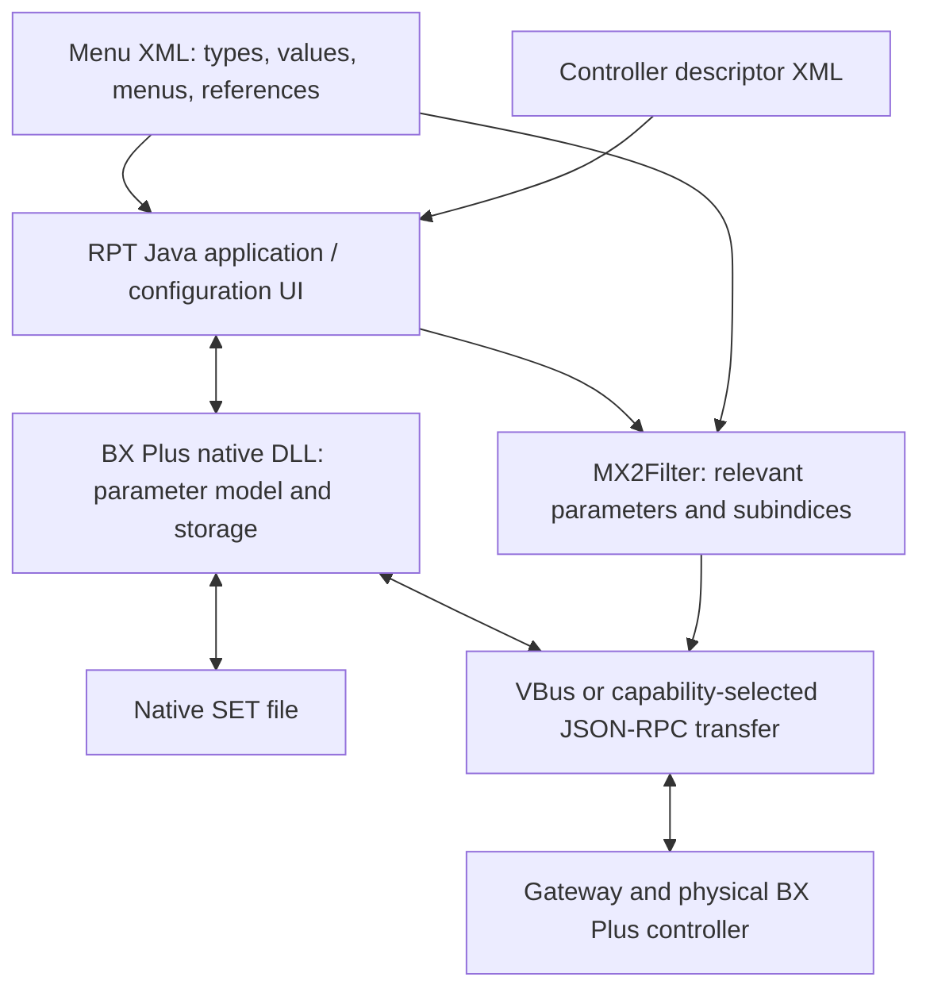
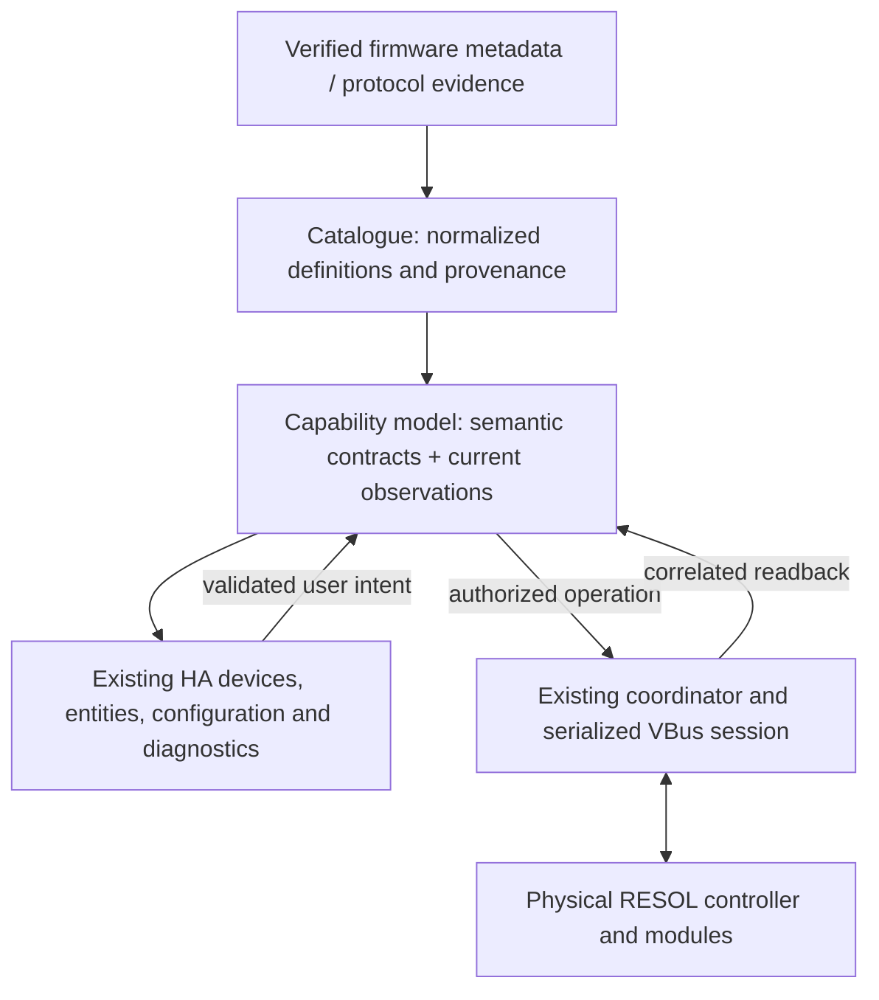

# RESOL DeltaSol BX Plus — interoperability research and integration architecture

**Research baseline:** RPT 2.02 / DeltaSol BX Plus firmware 2.08 · 28 November 2026  
**Status:** Whole-stack investigation in progress; static findings recorded, implementation and runtime qualification incomplete.  
**Implementation baseline:** [cc2ed482](https://github.com/npinguin/hass-Deltasol-KM2/commit/cc2ed482bf9e0183343bf94c4383e7593bb81a85) · [configuration scope #10](https://github.com/npinguin/hass-Deltasol-KM2/issues/10) · [development PR #18](https://github.com/npinguin/hass-Deltasol-KM2/pull/18).

## 1. Why this research matters

The original Home Assistant integration provides valuable access to RESOL telemetry through gateways such as the KM2. Reading measurements is not the same problem as understanding the configuration of the controller behind that gateway. A temperature, relay state or parameter name does not establish which equipment is installed, whether a setting is meaningful, whether it can be changed or whether a change survives a restart.

The goal of this work is a complete, maintainable configuration and operational integration for the supported BX Plus controller, rather than a collection of individually reverse-engineered controls. An owner should be able to discover the actual controller and modules, inspect their real settings and adjust supported operating parameters through native Home Assistant controls. An engineer should be able to understand unavailable capabilities, validate changes and diagnose communication failures. The controller remains responsible for autonomous operation and safety.

To get there, we investigated the entire relevant RESOL RPT-to-controller stack: the Windows installer, Java application, controller import package, menu/type definitions, native firmware-model DLL, parameter addressing, offline SET files, VBus commands and storage lifecycle. This is interoperability research at controller-system level, not merely a packet capture or a list of register addresses. It is also not a claim that every firmware routine, conditional function or physical behavior has been verified.

The upstream proposal is to reuse the existing integration and extend it with a coherent, evidence-driven configuration engine. No second application, Windows runtime, vendor DLL dependency or replacement control system is required in Home Assistant.

## 2. Research sources and method

We used three complementary kinds of evidence:

| Source | What it can establish | What it cannot establish alone |
| --- | --- | --- |
| RPT 2.02 application and BX Plus 2.08 import package | Vendor-side structure, parameter types, selection logic, native encoding and command implementation | Behavior of every deployed controller or physical persistence |
| Two genuine controller SET exports, before and after a timer configuration change | Actual storage records and differences produced by the native configuration workflow | Live VBus acknowledgement, safe write access or physical power-cycle retention |
| Existing integration, upstream protocol references and earlier field diagnostics | Current implementation, protocol conventions, actual communication symptoms and regressions | A successful end-to-end qualification of the new candidate |

The installer was extracted offline without executing it. Java bytecode and the native DLL were inspected statically; XML definitions and binary tables were compared systematically, and both SET files were parsed and compared. Native entry points and relative virtual addresses (RVAs) are recorded in the technical appendix for reproducibility. No vendor source code, binaries, private configuration files, credentials or site values are included in this document or proposed for distribution.

Evidence terminology used throughout:

- **Static verified:** a relationship is demonstrated in the examined binary, XML or file data.
- **Observed:** an actual capture or export contains the stated evidence.
- **Inferred:** a plausible interpretation still needs independent confirmation.
- **Qualified:** the implemented behavior has passed its relevant runtime acceptance test. Source tests and simulated peer behavior do not by themselves establish physical behavior.

The firmware package examined here has the same controller address and changeset as the package currently pinned by the integration, but a different archive digest. Member-level equivalence must be established before promoting the new binary findings to the existing registered catalogue trust boundary. A matching changeset is not a substitute for verifying the source.

## 3. How RESOL RPT actually works

RPT is more than a graphical editor. It loads a controller-specific package that combines a declarative description with a native implementation of the controller's parameter model. The native model is used to interpret and transfer configuration, while the Java layer manages the menu, selection and communication workflow.



The diagram is a conceptual view of the observed responsibilities, not a claim that every RPT execution path follows a single call sequence.

The descriptor identifies the controller, firmware version, changeset, native library, menu XML, parameter filter and storage format. The menu XML describes values, inherited types, units, limits, defaults, references and menu conditions. The native DLL contains parameter lookup tables, internal data representation and storage conversion. The Java application queries and transfers the appropriate values, using firmware-specific selection and capability-dependent communication paths.

The essential distinction is between **what could exist in a controller family**, **what is present in the installed configuration**, **what can currently be read**, and **what can safely be edited**. These are separate questions.

## 4. What the BX Plus investigation established

### 4.1 Controller identity and complete definition inventory

| Item | Observed result |
| --- | --- |
| Controller | RESOL DeltaSol BX Plus 2.08 |
| Controller address | `0x7112` |
| Changeset | `0x2734DABC` |
| RPT parameter filter | `MX2Filter` |
| Storage version | 3 |
| Menu XML | 15,680 value definitions; 993 menus |
| Native parameter table | 15,683 IDs |
| XML-to-native index coverage | All 15,680 XML indices found in the native table |
| Native hash/index matches | 10,649 XML entries |
| XML-only hashes | 5,031 with no native hash mapping |

Three additional native entries, 54, 57 and 58, correspond to descriptor skip-on-write IDs. Their presence is not permission to expose them as configuration controls.

The distinction between index coverage and hash coverage is important: a definition may exist at a native index without being addressable through the hash lookup. A failed hash lookup is not proof that the value cannot be read by another verified method. Equally, an index in the table is not proof of availability or write access. Discovery must report those distinctions instead of inventing values or silently excluding unknowns.

### 4.2 Types, menu conditions and dynamic configuration

The catalogue contains inherited types, display and storage scaling, enumerations, units, quantization, defaults and conditional references. The Java MX2Filter selects transfer parameters iteratively using storage classification, controlling values and, for applicable categories, explicit editable-action membership. This transfer selection is distinct from menu rendering and authorization.

Examples of selectors include:

| Family | Relevant context |
| --- | --- |
| Solar base and dedicated solar functions | Solar SystemId and native function context |
| Generic optional functions | Function Type and selected instance |
| Extension modules | Module activation and observed module identity |
| Heating circuits and functions | Circuit/function type and installed assignments |
| Heat quantity meters | Meter type and configured inputs |
| Weekly programs | Allocation, initialization and function references |

This selection mechanism explains why a flat list of every XML value is not an adequate configuration UI. It also suggests a more efficient discovery order: read controlling values first, then prioritize their dependent values, while retaining complete safe readable coverage and explicit unresolved results.

Important limitation: the RPT transfer filter is not a complete semantic permission model. In particular, a nonzero SystemId does not by itself establish a specific hydraulic topology, and the precise menu masks, compound dependencies and native assignment semantics are not yet fully reconciled. Do not infer applicability from function ordinals or write permission from menu membership.

### 4.3 Offline SET files

The two actual SET exports each contain 107 blocks of 512 bytes and 7,493 unique parameter records. All records map to native IDs; 7,492 map to XML definitions and one maps to extra native ID 54. Both files have the same key set, with 19 changed values. All 107 block-header CRCs per file were verified.

The 7,492 XML-matched stored records omit an explicit XML storage attribute. The RPT Java model initializes this category to Preferences (storage code 0), rather than unknown. These records cover the entire set of 7,492 XML values with omitted storage attributes in this archive. Preserve both the declared attribute and the effective RPT classification. Absence of that attribute is not sufficient to classify a parameter as nonpersistent or unsupported. Conversely, a parameter appearing in a SET file does not automatically establish that it is safe to write through Home Assistant.

SET files are useful independent evidence for storage layout and round-trip tests. They are not a proposed second live configuration store, and importing a full SET file into a physical controller is outside the agreed integration scope.

### 4.4 Weekly timer: from native bytes to a usable schedule

The catalogue defines 51 weekly program slots (Wsu0 through Wsu50), with seven daily payloads per slot. The native allocator actually supports 50 programs, Wsu1 through Wsu50; Wsu0 has an empty runtime lookup entry (see section 4.12). Each day contains six start/end pairs. An allocated and initialized program differs from an unallocated slot; references from functions link to programs and may not be assumed to confer exclusive ownership.

| Property | Verified representation |
| --- | --- |
| Daily payload | 12 bytes / three 32-bit words |
| Daily values | Six start/end pairs |
| Time unit | 15 minutes |
| Native range | 00:00–23:45 (0–95) |
| Unused pair | FF FF |
| Native descriptor | 0x400C for all 357 timer-day parameters |
| Word order | Successive groups of four bytes, little-endian |
| Allocation and initialization | Separate native parameters; 50 allocatable programs |

For a synthetic example, 08:00–10:00 becomes byte values 32 and 40 (hex 20 and 28). Unused trailing pairs are FF FF. This example is not a site configuration.

```text
Day bytes:  20 28 FF FF | FF FF FF FF | FF FF FF FF
Subindex:       0       |      1      |      2
Word:       0xFFFF2820  | 0xFFFFFFFF  | 0xFFFFFFFF
```

The JNI read/write routines, native SET serialization and native VBus parameter handler address the same underlying byte buffer at subindex × 4. The Java filter calculates the number of subindices from the inherited size. This is direct static evidence of the encoding, independent of plausible-looking decoded values.

**Implementation finding:** the current Python catalogue parser looks for a child element named size, whereas this firmware's type declares size="12" as an attribute. Correcting inheritance handling will remove an unnecessary workaround for these timer definitions once the registered archive is reconciled.

The static mapping is now established for the examined DLL. Full schedule ownership, live coherent reads, validated editing and failure recovery are still required before the schedule can be called delivered. No fictitious midnight sentinel or unrestricted Blob editor is needed.

### 4.5 Parameter writes, storage and bulk transactions

A controller parameter can represent a live value, volatile operating command, persistent setting or internal state. Their transport and storage behaviors are not interchangeable. The established scalar protocol distinguishes volatile write (0x0200) from write with save (0x0400), subject to a verified semantic contract.

The native BX Plus DLL also implements a multiword bulk transaction. The capability response contains the bulk-support bit 0x08. However, the word "transaction" must not be interpreted as a guarantee of database-style atomicity.

| Operation | Static native observation |
| --- | --- |
| Begin (0x1400) | Enter bulk transaction state |
| Stage (0x1500 plus subindex) | Update the underlying parameter buffer directly and mark storage dirty |
| Commit (0x1402) | End the transaction and invoke the storage lock-release/flush path |
| Expiration | Clear the transaction state; restoration of previous values was not observed |
| Rollback (0x1404/0x1405) | No corresponding branch found in the examined dispatcher or Java API |

The Java RPT transfer workflow starts bulk transfer, sends values and commits on completion. It does not establish an atomic rollback guarantee. This firmware finding contradicts the atomic staging and rollback assumption in the current unused Python packed-write helper and its simulated peer tests.

**Consequence:** a failure on the second or third word, or a lost commit acknowledgement, can leave an uncertain or partially applied configuration. Recovery must reconcile every word after regaining the session, distinguish previous, intended, partial and unavailable values, and never blindly repeat a mutation or claim successful rollback. The correct behavior of the native flush path and persistence after reconnect/restart must be qualified. Physical power-cycle retention is separate evidence.

### 4.6 Bus ownership, communication failures and relay recovery

The controller offers bus access; acquisition, address matching, request/reply correlation and release are part of the protocol, not optional housekeeping. The RPT Java implementation provides a useful reference for waiting for a fresh free-bus offer and resynchronizing after release on an authenticated connection.

Earlier field observations showed intermittent acquisition failures after manual relay override, including stale last-known modes. A previous fork correction preserves relevant release-parser evidence, but the precise physical cause of recurring offer/response failures remains unresolved. HTTP telemetry availability is not proof of VBus control availability.

The integration must serialize all operations, prioritize foreground controls over discovery, distinguish acquisition/command/release/verification failures, and never present a requested relay mode as authoritative readback. A lost response is not permission to retry a physical command. Relay recovery remains a priority regression under issues [#5](https://github.com/npinguin/hass-Deltasol-KM2/issues/5) and [#8](https://github.com/npinguin/hass-Deltasol-KM2/issues/8).

### 4.7 Detailed menu, storage and type model

Further static examination of the exact supplied XML and Java bytecode establishes the following inventory:

| Item | Count |
| --- | ---: |
| Named root types | 3,197 |
| Type nodes including inline types | 18,877 |
| Menu lines | 13,076 |
| Lines with valueRef | 8,600 (6,031 distinct values) |
| Lines with masks | 7,918 |
| Distinct comma-delimited mask tokens | 1,776 |
| Mask tokens matching a declared value ID | 204 |
| maskVal attributes | 336, all resolving to value IDs |
| extraRef / textRef lines | 1,986 / 1,767 |
| Compound value references | 3,259 |

MenuSystemInfo.LineInfo splits masks into tokens and joins compound masks with a double underscore. It resolves maskVal in global scope and extraRef in local context. Some tokens are presentation controls (e.g. Indented1), some represent access levels and some refer to native predicates (e.g. Solar_Vorhanden and Solar_WfX_IstVorhandeneFunktion). Most are not direct value IDs. Consequently a generic Boolean expression evaluator over current parameter values would not reproduce native menu visibility.

The Java menu model distinguishes an edit action (action code 3) from a value reference. MX2Filter.initEditableValueInfos selects resolved explicit edit actions. No explicit action attributes or elements were found in the supplied BX Plus menu XML; its line children are text. The generic Java edit-action mechanism therefore does not by itself prove that any particular BX Plus menu line is writable. Native callbacks and semantic contracts remain necessary evidence. Do not create write controls from valueRef, masks or labels alone.

The RPT MenuValue storage constants and exact XML counts are:

| Declared storage | Effective category | Java code | Count |
| --- | --- | ---: | ---: |
| Omitted | Preferences | 0 | 7,492 |
| volatile | Volatile | -1 | 3,123 |
| abstract | Abstract | -3 | 2,438 |
| struct | Struct | -2 | 1,915 |
| persistent | Persistent | 1 | 712 |

The Java model also defines Auto (-10). The default field initialization is zero, and parsing an explicit attribute changes that classification. The existing Python catalogue defaults omitted storage to unspecified; this loses the distinction between omitted declaration and known RPT default. The correct normalization retains raw provenance while recognizing Preferences, without translating all preferences to persistent or granting write access.

The generic getAllStorageParameters path includes preferences and the allowParameterization flag. MX2Filter.getRelevantValueIds first excludes handled IDs and negative storage categories, then considers preference, explicit flag or positive storage with confirmed edit action, deferring unresolved selectors and excluding zero selectors. All 21 explicit allowParameterization entries in this XML belong to abstract (14) or volatile (7) categories, illustrating why a generic flag is not sufficient to authorize a transfer or mutation. The two Java selection paths have different purposes.

Compound references occur across preferences (2,744), persistent (308) and volatile (207). Preserve parent-child identity and resolve current context rather than treating the children as unrelated independent registers.

TypeInfo inherits storage and display factors (default 1), applies storage conversion with rounding, and resolves inherited limits/defaults in integer storage space. The finest quantization is the last declared level; 13 types have multiple quantization levels. Proxy types reference flow, temperature/hysteresis, power or pressure selectors. For example, temperature and hysteresis proxies share a selector; a change in presentation unit must not change native identity or reinterpret a raw value with a stale factor. The HA implementation must reject invalid user input rather than indiscriminately rounding it. Validate each selected type, scaling, limits and step against the actual resolved native representation.

**Architectural implication:** definition, applicability, readability, write authorization and storage behavior are independent attributes of one capability. A menu can display an item that is read-only; a stored value can be inactive; a volatile command can be valid without a durable representation.

### 4.8 Solar topology and optional function dependencies

The native model contains an exact topology lookup table, rather than merely a numeric SystemId interval. The Solar_SystemId parameter (index 3416) has native callbacks for interpretation and presentation. Its positive integer value decomposes into three decimal fields. The RESOL manual beginning with firmware 2.07 (pp. 20–34, dotted system notation) independently identifies the first two fields as collector-field count and store count, and the third as hydraulic variant. The native topology allocation and mask-bound callbacks corroborate this interpretation:

```text
A = (SystemId // 10000) % 100  # collector fields
B = (SystemId // 100) % 100    # stores
C = SystemId % 100            # hydraulic variant
SystemId = 10000 * A + 100 * B + C
```

The exact lookup table contains 28 eight-byte records, one of which is ID 1 (fields 0,0,1; remaining topology attributes zero). This is consistent with a no-topology record, not the value zero. The other 27 recognized IDs are:

```text
10101 20101 20102 30101 30102
10201 10202 10203 20201 20202 20203 20204 20205
30201 30202 30203 30204
10301 10302 10303 20301 20302 20304 20305
10401 10402 10403
```

The lookup validates exact combinations and supports partial selection; for example, 20304 is present but 20303 is absent. A native allocation path uses additional record attributes and the selection routine dispatches according to the decoded fields. The two counts are stored in native configuration context offsets 0x1185 and 0x1186 (allocation at RVAs 0x2cec4 and 0x2ced2). The physical meaning of all additional table bytes and exact variant-specific output allocations is not yet proven. Use actual live assignment references rather than generating fixed terminal mappings from these bytes. The menu contains up to five store slots, but the 28-record topology table has a maximum of four stores; a catalogue slot is not a supported or installed topology. Neither the XML numeric interval nor its default 10101 establishes an installed hydraulic topology. In particular, a nonzero selector used in a transfer filter is not a proof of Solar installation.

The XML defines up to three collector groups, five store groups and ten Solar relay slots. It contains 18 dedicated Solar function groups (three tube collector, three bypass, one CS bypass, three frost protection, five external heat exchanger, one target temperature, one readiness and one drainback) and 16 generic Type/Nr groups. Dedicated and generic functions must use the same capability representation, but their dependencies must be resolved from actual function identity, topology and assignments.

For instance, base collector/store sensor-number fields and base relay-number/function fields are volatile, whereas external heat exchanger function sensor and relay assignment fields include Preferences. A name ending in Nr does not establish storage or applicability. Tube collector time window/runtime/pause and external exchanger differential/runtime/target controls need function-specific applicability evidence, not a separate transport or discovery engine. Safety protection and hydraulic reconfiguration remain excluded from operational writes under the agreed scope.

The Java optional-function import postprocessor explicitly orders nonzero Type/Nr configurations as disable type, assign number, restore type. A zero type suppresses that sequence. This establishes that full RPT import can perform disruptive reconfiguration, rather than simply writing independent scalar preferences. Do not reproduce this workflow in routine HA operational edits or silently activate functions.

### 4.9 Commit, inactivity and persistence boundaries

Further inspection of the native begin/stage/commit path shows that the bulk session has an inactivity counter and an associated storage lock. Begin initializes the requested positive timeout and acquires the lock; each stage resets the inactivity counter and mutates the underlying data. Expiry clears transaction state, and no restoration of already mutated words was identified.

On commit, the native handler checks that a transaction exists, clears transaction state, triggers the lock-release path and returns success. When the last storage lock is released, dirty-store flags are scheduled for further processing. The examined return path does not wait for or verify durable physical storage. A successful commit acknowledgement is therefore not a durable-storage receipt.

The Java virtual model also has deferred storage behavior: Storage updates its buffer and schedules a worker after 2,500 ms; StorageMX uses a 5,000 ms deferred path for custom storage and a separate explicit flush path. These are observations of the Java implementation, not a timing guarantee for a deployed controller. Do not turn these delays or native counter values into a fixed physical persistence timeout.

The implementation must distinguish applied/read-back data, acknowledged completion, uncertain partial application and independently verified retention. Reconnect reconciliation must compare all affected words against previous and intended states. The independent test peer must model immediate mutation, lost responses, expiry, deferred persistence and mixed readback. No automatic replay or rollback assumption may hide an uncertain write.

### 4.10 RPT transport recovery versus the current integration

The Java TransferSerial.getValueById path uses bounded retry of a read, then release and reacquisition on the same authenticated connection, awaiting a fresh offer and verifying the expected controller source. AbstractVBusConnection.releaseBus sends 0x0600 without an explicit release acknowledgement. This is a read-recovery reference, not authorization to retry a physical write.

The current Python open_vbus establishes a fresh TCP connection; its release path sends 0x0600 and waits for the expected master's traffic, with a conditional second release only on silence. Both paths distinguish controller identity and communication state, but their connection lifecycle is different. This difference is a concrete diagnostic hypothesis for the field acquisition/release regression, not its established root cause. Compare actual offer/request/release traces before changing session lifetime or weakening address, correlation or safety checks. Preserve the single bus owner.

### 4.11 Native dynamic constraints and schedule ownership

The complete menu XML contains no explicit constraint elements, even though the native controller provides relational editing bounds. The complete index-to-descriptor join gives a useful explanation: all 15,680 XML indices point to descriptors containing two code pointers within the DLL text section, including abstract and structural entries. In the Preferences category alone (7,492 definitions), 1,757 distinct first callback addresses and 149 distinct second callback addresses are present. Callback presence is not equivalent to read/write authority; the pointer pair and data representation are separate from menu context. It does show why reproducing only XML min/max values is insufficient.

Offline inspection of the original DLL, using the sorted native parameter index table (RVA 0x183500) and descriptor pointer table (RVA 0x18afa0), joined each selected XML parameter to its 16-byte descriptor. The descriptor contains the value pointer, descriptor flags and two code pointers. The following rules are directly supported by the bound callbacks and the shared min/max helpers:

| Family | Coverage inspected | Dynamic bound | Evidence |
| --- | --- | --- | --- |
| Collector selection mask | Tube collector mask callback | (1 << configured collector count) - 1 | RVA 0x23850 reads context +0x1185 |
| Store selection mask | External exchanger mask callback | (1 << configured store count) - 1 | RVA 0x238e5 reads context +0x1186 |
| Tube collector start/end | 3/3 slots, both bounds | End >= start + 30 minutes; reciprocal start maximum | First pair RVAs 0x77687 / 0x77701, remaining pairs 0x7777b / 0x777f5 and 0x7786f / 0x778e9 |
| External exchanger on/off differential, K | 5/5 slots, both bounds | On >= off + 0.5 K | First pair RVAs 0x789dd / 0x78b1f; raw margin 5 with factor 0.1 |
| External exchanger on/off differential, R | 5/5 slots, both bounds | On >= off + 1 °R | First pair RVAs 0x78a59 / 0x78b9b; raw margin 10 with factor 0.1 |

All 13 relational pairs (26 callbacks) were compared offline: each callback references the correct opposite parameter's native index and value pointer, invokes the appropriate min/max tightening helper (RVAs 0x10cdec / 0x10ce24) and applies the expected raw offset. For tube collector time bounds the native offset is 30 in minute representation. These callbacks conditionally tighten the editing bounds based on current context. They establish a valid operational constraint, not proof that an arbitrary raw VBus write always applies the same validation.

This gives an implementation-ready pattern: bind the native family once, derive instances from verified metadata, require live assignment/activation and selected representation, check the dependent values in the same serialized operation, and reject an invalid pair before mutation. Keep the conservative conditional-write gates until the relevant function-presence evidence is established. Do not infer a 7-bit collector or 31-value store mask is valid solely from its XML maximum. The native mask callbacks demonstrate the difference between a schema capacity and the installed configuration. Do not expose topology/assignment mutations under the guise of operating parameters.

Weekly schedule ownership was also examined across the full type inheritance tree. There are 74 value definitions inheriting WochenschaltuhrNr: 16 arrangement functions and 58 heating function/circuit/room-thermostat references. All 74 are Preferences and bind to the same native callback pair (RVAs 0x549ae and 0x54a34); the first callback sets a reference interval of 0–50, consistent with XML. Each of the 51 Wsu slots contains its own Belegt allocation flag, volatile Ttl field, initialization flag and seven daily payloads. The native callback does not establish exclusive ownership or the full lifecycle of allocation/release. A range containing zero does not authorize treating Wsu0 as an ordinary user-editable allocated program. Keep the distinction between a slot, a live reference and its actual active owners. Before editing, re-read allocation, initialization, relevant references and function context; show shared ownership when observed. Do not auto-allocate or reassign a schedule merely to expose a control.

**Implementation implications:** the next V1 changes should correct the metadata parser, introduce family-based dependent constraints using the existing Setting/ConfigurationCapability model, complete the schedule editor on the corrected transport, and qualify failure recovery. Native callbacks can be studied further where a supported operation lacks evidence; it is not necessary to reimplement the controller's autonomous hydraulic algorithm or every display routine. The remaining exact menu predicate/assignment semantics and timer allocation lifecycle must not be described as solved. Retain the entire agreed functional outcome and distinguish intentionally excluded safety/commissioning operations from unfinished operational functions.

### 4.12 Native weekly-program lifecycle

The complete allocation table and its consumers were located in the supplied DLL. This resolves the difference between the 51 catalogue slots and the actual runtime pool of 50 usable programs. Offline comparison of the native table to XML descriptors established:

- Entry zero is empty (all eight bytes zero). Lookup accepts only 1–50, returning entry zero for an out-of-range reference. Wsu0 is catalogue evidence, not an editable runtime program.
- All 50 nonzero entries match both root and week structure IDs and their Monday-data and TTL pointers.
- All 51 catalogue slot layouts have a stride of 88 bytes: seven consecutive 12-byte day payloads (84 bytes), initialization at offset 85 and allocation at offset 87. The native TTL is held in a separate volatile byte array, not in the 88-byte persisted program structure.

| Native routine (RVA) | Observed behavior |
| --- | --- |
| 0x372f4 | Lookup bounded to 1–50; zero and invalid references select empty entry |
| 0x37369 | Count unallocated entries |
| 0x373c1 | Scan for first free slot; clear 88-byte structure, set allocation, initialize a template for specified reference IDs, mark storage and reset TTL; return -1 when none found |
| 0x104ac | Native UI path reads existing reference; when absent, allocates a slot, writes the resulting reference, then enters editing context |
| 0x378f4 | For a valid allocated slot, reset volatile TTL to zero; called by function/circuit paths |
| 0x37937 | Clear an allocated slot and mark storage |
| 0x379a5 | Sweep slots 1–50: clear TTL for unallocated slots; increment TTL while allocated and <=9; otherwise clear the 88-byte structure and mark storage |

The sweep is invoked by the native scheduler (call at RVA 0x35e10); the real-time duration of a sweep is not established. TTL is an aging/retention counter, not an ownership count and not a remaining-seconds measurement. The function callers refresh it by passing the stored program reference. There is no guarantee a slot remains allocated indefinitely merely because it was once observed.

Allocation is also **context-dependent**. The native routine compares 42 specific reference IDs, all verified against the 74 XML weekly references, corresponding to seven heating circuits with their five room-thermostat references. For these, it sets the initialization bit and copies a native 06:00–22:00 daily template into all seven days (remaining windows unused). The other 32 references do not enter that template branch. This is a vendor initialization rule, not an HA recommendation or a live value. The original SET pair independently demonstrates another context where an allocated, initialized program has user-entered daily values.

Implications for V1:

1. Only edit a currently allocated, initialized, positively linked nonzero program. Distinguish unavailable/expired/reallocated from an empty initialized day.
2. Reconcile active referencing functions before the mutation and all affected day words after it. A change belongs to the program itself, not to an arbitrarily chosen referencing function; if multiple owners are observed, clearly show the shared effect. Do not assume exclusivity merely because an initial capture contained one reference.
3. Revalidate allocation/reference context for every operation; if a slot has expired or changed ownership, reject stale intent. Preserve stable slot identity without confusing old content with a new allocation.
4. Creating and assigning a new program is a separate controller configuration operation with native allocation/initialization semantics. Do not invent an allocation by writing flags, copy vendor defaults into live state or manipulate TTL to keep a slot alive. Installed-program mapping remains read-only under the agreed issue #10 boundary; editing existing verified schedules remains in scope.

This is direct static evidence for the native lifecycle, not an executed physical allocation or retention test. The program-to-active-function predicates still require confirmation for each exposed context. The tests should include zero reference, a freed slot, reallocation between observation and edit, shared references, uninitialized/empty schedules, and partial or uncertain updates.

### 4.13 Registered firmware equivalence

The supplied ZIP and pinned ZIP have different container hashes. To remove the remaining evidence gap without changing runtime trust, compare the four member SHA-256 digests through the existing exact-vendor-archive developer test in CI, which already retrieves the registered archive. This is a research/source compatibility check; the pinned archive digest remains authoritative. The first comparison ([source run 46133111124](https://github.com/npinguin/hass-Deltasol-KM2/actions/runs/46133111124)) established byte-identical descriptor XML, menu XML and controller image, but a different DLL digest (registered `a5b6ecc469c65fdd45b49a1c3f1543973677720a8fcf40f1ea363c483982a71c`; supplied `2e850d5a6764488efc4405f88c1249b1bbaae1cfead416c5edc95e91873f7e43`). The full-member equality test correctly failed. Compare PE layout, image base, section flags and section content next; a different whole-file hash does not establish different executable code, nor does identical XML prove binary equivalence. Until that comparison is complete, do not promote supplied-DLL findings as registered-binary evidence. No additional workflow, vendor binary redistribution or network runtime dependency is introduced.

## 5. Architecture: a single native Home Assistant integration

The proposed implementation direction builds on the existing Python components instead of importing RPT into Home Assistant. The native controller remains the authority for actual configuration, telemetry and physical control. RPT and other verified sources provide evidence for how to interpret those capabilities.



These are responsibility boundaries in the existing implementation, not a proposal for additional services or a new framework.

| Responsibility | Existing code to reuse | Direction |
| --- | --- | --- |
| Source validation and catalogue | [catalog.py](../custom_components/deltasol/catalog.py) | Exact identity, digest and inherited metadata; preserve provenance and conflicting definitions |
| Controller and relay profiles | [parameters.py](../custom_components/deltasol/parameters.py) | Verified semantic contracts, actual module identity and stable capability keys |
| Discovery and snapshots | [discovery.py](../custom_components/deltasol/discovery.py) | Bounded resumable reads, selector-aware ordering, explicit unknowns, complete safe coverage and packed values |
| Configuration policy | [configuration.py](../custom_components/deltasol/configuration.py) | Type, range, scaling, installed dependencies and write authorization; one model |
| Native HA projection | [configuration_entity.py](../custom_components/deltasol/configuration_entity.py) and existing HA platforms | Native controls and accurate availability; preserve existing identifiers and history |
| Communication and ownership | [deltasolapi.py](../custom_components/deltasol/deltasolapi.py), [vbus.py](../custom_components/deltasol/vbus.py) | One serialized owner, exact request/readback correlation, real partial-write and recovery semantics |
| Diagnostics and regression | [diagnostics.py](../custom_components/deltasol/diagnostics.py), [tests](../tests/) | Truthful evidence, redaction, lifecycle and backward compatibility |

A capability is not simply a register. It has a stable semantic identity, source controller/module, applicable type, constraints, current observation, access and storage semantics, and a verified operation where applicable. The same capability is used for discovery, diagnostics and native HA projection. Its identity must not depend on a catalogue digest, provider name, transient parameter index or changing display label.

Definitions can come from more than one source in the future. Live observations and write authorization remain separate from descriptive metadata. Unknown, unavailable, refused, stale and conflicting are legitimate states, not zero values or defaults. Do not create a second cache, discovery service, writer or user-facing generic register API.

Safety-critical protection settings, hydraulic topology, credentials and unsupported operations remain read-only or excluded as appropriate. Existing autonomous controller safety and configuration are not replaced by HA. This is a real product boundary, not a justification to omit verified in-scope operational controls.

## 6. Implementation direction for V1

The approved functional scope remains DS-PAR-01–05 in issue #10. The table below describes how the research changes the implementation approach, not a new requirement register.

| Step | Required outcome | Acceptance evidence |
| --- | --- | --- |
| Reconcile evidence | Match the pinned and supplied archive members; finish native menu, storage and dependency analysis | Exact artifact fingerprints, reproducible mappings, explicit unresolved cases |
| Correct catalogue | Read size attributes and inheritance consistently with RPT; retain genuine metadata provenance | Exact archive tests for all 357 daily definitions, storage default, inherited scaling/quantization, conflicting and malformed declarations, no unverified write grants |
| Complete discovery | Prioritize selectors, exact topology and installed assignments, preserve full safe readable inventory, distinguish unresolved values | Native IDs, live applicability, bounded interruption/resume and snapshot comparison |
| Correct transport | Remove false atomicity assumptions; reconcile partial or uncertain writes and relay acquisition/release | Independent peer applies words immediately; stage failure, lost commit, reconnect, stale values and no blind retry |
| Complete native configuration | Verified schedule read/edit, relevant operating parameters and conditional Solar/heating/module functions | Live dependencies, 3 tube collector pairs and 10 exchanger unit-specific pairs, schedule ownership, native actions, exact readback and persistence; no duplicate writer |
| Qualify the full batch | Preserve existing 1.2.16 functionality and complete the agreed 1.2.17 scope | Exact candidate source gates, actual isolated HA lifecycle, actions, recovery, upgrade, restart and exact predecessor rollback |

The weekly editor must use the existing owner, validate complete days and ownership before any mutation and report the authoritative final state. A partial write is not success. A recovered state that differs from both the original and requested schedule requires explicit reconciliation; the UI must not hide the discrepancy. No new HA UI framework is required: select the smallest native HA surface that provides a genuinely usable schedule editing journey, and verify it end to end.

The order above does not authorize new feature implementation before the outstanding RPT analysis is sufficiently resolved. Keep the existing development batch and scope. Do not publish an incomplete TEST merely because the source checks pass.

## 7. Future support and upstream contribution

### V2: build on the same model

A future version can investigate RESOL's open-source protocol tooling (including resol-vbus-core) and other independently verified catalogues to broaden controller and firmware support. That is an extension of the same capability model and communication owner, not a second runtime or mandatory new dependency. The current V1 catalogue is firmware-specific; it does not prove generic support for all BX, MX or other controller variants.

Before enabling a new controller, identify its actual address and changeset, compare source provenance and conflicts, verify address/encoding/storage rules and test its semantic operations. Keep existing IDs, history, settings and offline local operation intact. Unknown firmware must degrade gracefully without disrupting telemetry or other independently supported capabilities.

### What makes this upstream-worthy

The intended contribution is an understandable and maintainable integration improvement backed by whole-stack research. It should be possible for an upstream maintainer to review the model, protocol assumptions, failure behavior and tests without using RPT or needing the original research environment. The existing upstream telemetry and supported gateway behavior must remain intact.

The contribution should explain what was learned, what code is reused, which existing assumptions were corrected and how each new capability is tested. Separate research facts, implementation changes and qualification results. Review license and redistribution rights before any third-party source, metadata or binary is included. This document describes independently established interoperability facts and contains no vendor binary, decompiled routine listing or private SET export. It does not assert a legal right to redistribute vendor material.

No upstream PR is submitted by this research document. Upstream review should follow completion and qualification of the agreed functional scope, with an appropriate reviewable change set and clear compatibility limitations.

## 8. Open research and proof boundaries

| Topic | Current conclusion | Evidence still needed |
| --- | --- | --- |
| Archive identity | Supplied controller/version/changeset match; ZIP digests differ | Member-level comparison with registered archive |
| Weekly mapping | Statically verified in supplied DLL and supported by SET data | Registered-source reconciliation, active owner predicates and live/isolated coherent read and edit journey |
| Bulk recovery | Native direct mutation, inactivity and queued storage behavior established; guaranteed rollback contradicted | Independent partial-application peer and qualified recovery behavior |
| Persistent storage | Preference defaults and native deferred storage path identified; commit is not a durability receipt | Complete restart/reconnect proof, physical retention separately |
| Solar/menu applicability | Native SystemId decomposition, counts and 28-record lookup verified; dynamic mask bounds and 13 paired constraints confirmed; menu and transfer selection separated | Remaining variant/assignment attributes, native presence predicates and all applicable function contracts |
| Relay stability | RPT read recovery and Python session lifecycle compared | Actual recovery root cause and qualified regressions; supervised site acceptance separately |
| Overall product | Active development, not feature complete | Full DS-PAR-01–05 and applicable DS-REL journeys, exact qualified HACS bytes |

At the audited source baseline, source CI passed; actual HA candidate qualification and publication were skipped because the PR was Draft ([pipeline](https://github.com/npinguin/hass-Deltasol-KM2/actions/runs/46130468050)). The last published TEST reported in the existing batch is 1.2.16. This document neither changes runtime code nor claims that the next release is complete.

## Appendix A — Reproducibility references

The following fingerprints identify the exact examined research inputs; the SET exports remain private.

| Artifact | SHA-256 |
| --- | --- |
| RPT ZIP (owner-supplied) | `23ae2e946848e78fb5a8e64f890379a595561a2d511c4b5a004b8ea0deec8974` |
| Extracted RPT Java archive | `f3415c06e8118572c7a5ccdb17ed2411f4719b439d4149282a455d58b3d581dd` |
| BXPLUS_2.08 ZIP (owner-supplied) | `385c12e6646c3aeb2efe45c24dd6b7b6f46fb179724408f24090bc44765f5b9e` |
| BX Plus DLL | `2e850d5a6764488efc4405f88c1249b1bbaae1cfead416c5edc95e91873f7e43` |
| bxplus_208.xml | `dcd82d53056e78b8a26209b9b4012f3b3787d12e2f835bf270cc7b616968ccd3` |
| BXPlus_208-Menu.xml | `5311e1a5c2da8fe606c8dc49093202e6607d93e1b51430e84a93d4a56ec6e60e` |
| Resol_BXPlus.png | `e70397a53ff8f09d79af19cb431e9f1b65e83af6f5cd4aafe35441e6bf3ee9c2` |
| Existing registered firmware archive | `1bcc59cac3d4176c68de255fced3b95840bada06db33b0bdae0cddb007a9f079` |

Native DLL RVAs below are inspection references, not portable entry points or a public API.

| Evidence | RVA / Java reference |
| --- | --- |
| Sorted parameter lookup and native hash tables | 0xb7673, 0xb778b, 0xb77d0 |
| JNI parameter read/write | nativeGetValuesById 0x7d79; nativeSetValuesById 0x7f88 |
| Storage byte serialization | 0xfe599, 0xfe4fa |
| VBus parameter handler | 0x4700f |
| Bulk begin / direct stage / commit | 0x476bf / 0x4785d / 0x477b1 |
| Storage dirty / lock-release and flush path | 0x1069f / 0xd4848 |
| Bulk expiration | 0x4d6f0 |
| Native storage lock / deferred store scheduling | 0xd47c1 / 0xd4848 / 0x100d2c |
| Solar SystemId descriptor / callback | 0x150d18 / 0x23e7b |
| Solar SystemId split / recomposition | 0x23c60 / 0x23d2f |
| Solar topology table / exact and partial lookup | 0x123520 / 0x25c79 / 0x25ce0 |
| Native topology selection / attribute access | 0x2611c / 0x23d4a / 0x01c04 |
| Java menu and storage model | MenuSystemInfo.LineInfo, MenuValue, TypeInfo |
| Java transfer selection and import order | MX2Filter.initEditableValueInfos, getRelevantValueIds, postProcessOptionalFunctions |
| Java deferred storage model | Storage.writeStorage, StorageMX.writeStorage |
| Java read recovery | TransferSerial.getValueById |
| Native index / descriptor pointer tables | 0x183500 / 0x18afa0 |
| Configured collector/store counts | Allocation 0x2cec4 / 0x2ced2; context offsets 0x1185 / 0x1186 |
| Dynamic min / max helpers | 0x10cdec / 0x10ce24 |
| Weekly reference callback pair | 0x549ae / 0x54a34 (all 74) |
| Weekly allocation lookup table / lookup | 0x124320 / 0x372f4 |
| Weekly free count / allocator / UI entry | 0x37369 / 0x373c1 / 0x104ac |
| Weekly TTL refresh / clear / sweep | 0x378f4 / 0x37937 / 0x379a5 |
| Weekly native heating template | 0x1244b8; 42 verified reference IDs |
| Parameter selection and packed IDs | MX2Filter.getRelevantValueIndices |
| Java transfer lifecycle | Controller.readDataFromLibrary, writeDataToDevice, Controller$7 |
| Bus acquisition / release | AbstractVBusConnection.waitForFreeBus, releaseBus |

SET file block-header CRC verification used reflected CRC16 polynomial 0x8408, initial and final XOR value FFFF, over the six-byte block header. This is a description of the observed format, not a general guarantee of whole-file integrity.

### References

- [RESOL DeltaSol BX Plus operating and installation manual, document 11202383](https://www.resol.de/Produktdokumente/Alte_Montageanleitungen/11202383_DeltaSol_BX_Plus.monen.pdf) — operating function definitions and native timer range.
- [RESOL DeltaSol BX Plus manual beginning with firmware 2.07](https://www.manualslib.com/manual/2406566/Resol-Deltasol-Bx-Plus.html) — pp. 20–34, dotted system numbers and output/sensor allocation. The older manual's ordinal system numbers must not be used as exact 2.08 SystemId mappings. The online table of contents was accessible; individual page retrieval failed, so the binary remains the authority for the exact 28-record list and dynamic bounds.
- [RESOL VBus Core parameterization guide](https://resol-vbus-core.bugstu.be/guides/vbus-parameterization.html) — independent protocol/mapping reference; not proof of BX Plus-specific storage behavior.
- [Original RPT binary audit evidence](https://github.com/npinguin/hass-Deltasol-KM2/pull/18#issuecomment-7237378673) — native analysis, source fingerprints and limitations.
- [Configuration scope and acceptance](https://github.com/npinguin/hass-Deltasol-KM2/issues/10) — authoritative work scope.
- [Active development and qualification record](https://github.com/npinguin/hass-Deltasol-KM2/pull/18) — current implementation and remaining work.

Maintain this research note when new evidence changes a conclusion. Keep actual work status and release decisions in the existing issue and PR, rather than turning this note into another project tracker.
